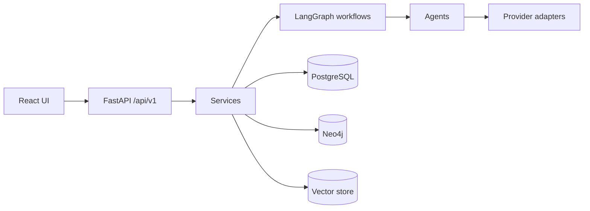

# AURORA

**Autonomous Web Research and SEO Intelligence Platform.** AURORA aims to turn
web sources into source-grounded research, SEO insight, and approved content.
The project is at the **foundation stage (Module 1)**: the API and project
structure exist; the research, agent, and integration features are planned.

## Status: implemented vs planned

| Area | Status |
| --- | --- |
| FastAPI app, config, logging, error handling | Implemented |
| `GET /`, `GET /api/v1/health`, Swagger docs | Implemented |
| `POST /api/v1/research` | Validation + **placeholder only** (`not_implemented`) |
| Pydantic schemas (research, SEO, content) | Implemented |
| React/TypeScript dashboard with research form | Implemented (scaffold) |
| URL safety check for crawling | Implemented (IP literals/schemes; no DNS checks) |
| Agents, LangGraph workflows | Skeletons — not functional |
| Firecrawl, SerpApi, Groq, Claude, WordPress, Search Console | Skeletons — no real calls |
| PostgreSQL models/migrations, Neo4j, vector store, RAG | Not implemented |
| Keyword research, SERP analysis, content generation, publishing | Planned |

## Technology stack
Python 3.12, FastAPI, Pydantic v2, SQLAlchemy 2, LangGraph/LangChain, Anthropic,
Groq, Firecrawl, PostgreSQL, Neo4j, ChromaDB, React 19, TypeScript, Vite 6,
Tailwind CSS 4, Docker Compose, pytest, Ruff.

## Architecture overview

Only the UI → API path is implemented; everything to the right is planned. See
[`docs/architecture.md`](docs/architecture.md).

## Folder structure
```
.claude/skills/   Claude Code planning skills (11)
backend/app/      api, core, agents, workflows, tools, research, seo, graph,
                  rag, database, schemas, publishing, monitoring, prompts
backend/tests/    pytest suite
frontend/         React + TypeScript + Vite app
docs/             design docs and module checklist
scripts/          helper scripts
data/             local generated data (git-ignored)
```

## Prerequisites
Python 3.12, Node.js 18+ with npm. Docker is optional (local PostgreSQL/Neo4j).

## Installation and backend startup (PowerShell)
```powershell
py -3.12 -m venv .venv
.\.venv\Scripts\Activate.ps1
python -m pip install -r requirements.txt
python -m pip install -e ".[dev]"
Copy-Item .env.example .env
$env:PYTHONPATH = "backend"
uvicorn app.main:app --reload
```
Swagger UI: <http://127.0.0.1:8000/docs>. No credentials or databases needed.

## Frontend startup
```powershell
cd frontend
npm install
npm run dev
```
Open <http://127.0.0.1:5173>. Vite proxies `/api` to `127.0.0.1:8000`.

## Testing
```powershell
python -m pytest
ruff check backend scripts
ruff format --check backend scripts
cd frontend; npm run build
```

## Environment configuration
Copy `.env.example` to a root-level `.env` (git-ignored). Every external
credential is optional. Variables: `APP_NAME`, `APP_ENV`, `DEBUG`, `LOG_LEVEL`,
`API_V1_PREFIX`, `DATABASE_URL`, `NEO4J_*`, `FIRECRAWL_API_KEY`,
`SERPAPI_API_KEY`, `GROQ_API_KEY`, `ANTHROPIC_API_KEY`, `WORDPRESS_*`,
`GOOGLE_*`. Never commit real values.

## API endpoints
| Method | Path | Description |
| --- | --- | --- |
| GET | `/` | Application info |
| GET | `/api/v1/health` | Liveness (no dependency checks) |
| POST | `/api/v1/research` | Validates request; returns a placeholder, starts no research |

Details: [`docs/api-documentation.md`](docs/api-documentation.md).

## Development roadmap
Persistence → research ingestion → SERP/competitors → knowledge graph → RAG →
SEO content → approval-gated publishing and monitoring. See
[`docs/development-roadmap.md`](docs/development-roadmap.md) and
[`docs/module-1-checklist.md`](docs/module-1-checklist.md).

## License
See [LICENSE](LICENSE).
