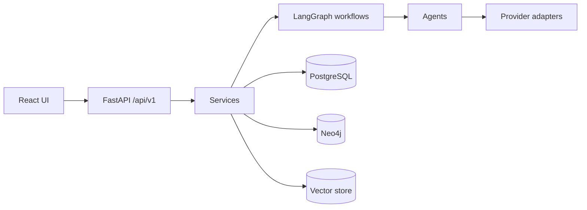

# AURORA

**Autonomous Web Research and SEO Intelligence Platform.** AURORA aims to turn
web sources into source-grounded research, SEO insight, and approved content.
The project is at the **Module 3 stage**: the web research engine (Module 2) and the
website intelligence engine (Module 3: website discovery, mapping, crawling,
structured extraction, evidence validation, reports) are implemented and tested
with mocked providers; agents, LLM features, graph/RAG, SEO content and
publishing are still planned. Live provider verification was done once with a
minimal budget (see `docs/module-3-checklist.md`); broader checks are pending (need your
API keys).

## Status: implemented vs planned

| Area | Status |
| --- | --- |
| FastAPI app, config, logging, error handling | Implemented |
| `GET /`, `GET /api/v1/health`, Swagger docs | Implemented |
| `POST /api/v1/research` | **Implemented (synchronous)**: search, validate, extract, persist |
| `GET /api/v1/research/{job_id}` | **Implemented**: retrieve a stored job and its sources |
| SerpApi and Firecrawl adapters | **Implemented** (HTTPX, retries); mocked tests pass; one minimal live check passed (see Module 3 checklist) |
| URL/SSRF policy, source dedup and provenance | **Implemented** (limits in `docs/security-and-ssrf.md`) |
| PostgreSQL models, Alembic migration, repository | **Implemented**; Postgres integration tests need a test DB |
| Website discovery, official-site assessment, page mapping/classification | **Implemented** (Module 3; mocked tests, live check pending) |
| Intelligent crawling (bounded batch scrape, fallback, robots pre-filter, audit) | **Implemented** (Module 3) |
| Content processing, structured extraction (deterministic), entity resolution | **Implemented** (Module 3) |
| Evidence validation (excerpt checks, conflicts, coverage) and JSON/Markdown reports | **Implemented** (Module 3) |
| `POST /research/websites`, `.../map`, `.../crawl`, `/intelligence`, `GET /{job_id}/websites|entities|claims|report|progress` | **Implemented** (synchronous) |
| LLM-based extraction | Interface only; no LLM adapter is implemented |
| Pydantic schemas (research, SEO, content) | Implemented |
| React/TypeScript dashboard with research form | Implemented (scaffold) |
| Agents, LangGraph workflows | Skeletons — not functional (`ResearchState` is ready for them) |
| Groq, Claude, WordPress, Search Console adapters | Skeletons — no real calls |
| Neo4j, vector store, RAG | Not implemented |
| Keyword research, SERP analysis, content generation, publishing | Planned |

## Technology stack
Python 3.12, FastAPI, Pydantic v2, SQLAlchemy 2 (async) + asyncpg, Alembic, HTTPX, LangGraph/LangChain, Anthropic,
Groq, Firecrawl, PostgreSQL, Neo4j, ChromaDB, React 19, TypeScript, Vite 6,
Tailwind CSS 4, Docker Compose, pytest, Ruff.

## Architecture overview

The UI → API → research service → SerpApi/Firecrawl/PostgreSQL path is
implemented (see [`docs/research-engine.md`](docs/research-engine.md));
workflows, agents, Neo4j and the vector store are planned. See
[`docs/architecture.md`](docs/architecture.md).

## Folder structure
```
.claude/skills/   Claude Code planning skills (11)
backend/app/      api, core, agents, workflows, tools, research, seo, graph,
                  rag, database, schemas, publishing, monitoring, prompts
backend/tests/    pytest suite
frontend/         React + TypeScript + Vite app
docs/             design docs and module checklist
scripts/          helper scripts
data/             local generated data (git-ignored)
```

## Prerequisites
Python 3.12, Node.js 18+ with npm. Docker is optional (local PostgreSQL/Neo4j).

## Installation and backend startup (PowerShell)
```powershell
py -3.12 -m venv .venv
.\.venv\Scripts\Activate.ps1
python -m pip install -r requirements.txt
python -m pip install -e ".[dev]"
Copy-Item .env.example .env            # then add SERPAPI_API_KEY / FIRECRAWL_API_KEY
docker compose up -d postgres          # PostgreSQL only (Neo4j is not started)
$env:PYTHONPATH = "backend"
alembic upgrade head                   # create the Module 2 + Module 3 tables
uvicorn app.main:app --reload
```
Swagger UI: <http://127.0.0.1:8000/docs>. The API **starts** without keys or a
database; research requests need both (otherwise they return `503`). Make sure
`DATABASE_URL` in your `.env` is `postgresql+asyncpg://...` (see `.env.example`).

## Frontend startup
```powershell
cd frontend
npm install
npm run dev
```
Open <http://127.0.0.1:5173>. Vite proxies `/api` to `127.0.0.1:8000`.

## Testing
```powershell
python -m pytest
ruff check backend scripts
ruff format --check backend scripts
mypy
cd frontend; npm run build
```
PostgreSQL integration tests and live provider tests are opt-in; see
[`docs/testing-guide.md`](docs/testing-guide.md).

## Environment configuration
Copy `.env.example` to a root-level `.env` (git-ignored). Every external
credential is optional. Variables: `APP_NAME`, `APP_ENV`, `DEBUG`, `LOG_LEVEL`,
`API_V1_PREFIX`, `DATABASE_URL`, `SERPAPI_API_KEY`, `FIRECRAWL_API_KEY`,
`RESEARCH_*` and `WEBSITE_RESEARCH_*` limits, `AURORA_RUN_LIVE_INTEGRATION_TESTS`, and (future) `NEO4J_*`,
`GROQ_API_KEY`, `ANTHROPIC_API_KEY`, `WORDPRESS_*`, `GOOGLE_*`. Never commit real values.

## API endpoints
| Method | Path | Description |
| --- | --- | --- |
| GET | `/` | Application info |
| GET | `/api/v1/health` | Liveness (no dependency checks) |
| POST | `/api/v1/research` | Runs a research job synchronously; returns sources with provenance |
| GET | `/api/v1/research/{job_id}` | Retrieves a stored job |
| POST | `/api/v1/research/websites` | Discover relevant websites for a subject |
| POST | `/api/v1/research/websites/{id}/map` | Map and classify a website's pages |
| POST | `/api/v1/research/websites/{id}/crawl` | Crawl selected pages, extract and validate facts |
| POST | `/api/v1/research/intelligence` | Run the complete website intelligence workflow |
| GET | `/api/v1/research/{job_id}/progress` `/websites` `/entities` `/claims` `/report` | Read job status and results |

Details: [`docs/api-documentation.md`](docs/api-documentation.md).

## Development roadmap
Persistence → research ingestion → SERP/competitors → knowledge graph → RAG →
SEO content → approval-gated publishing and monitoring. See
[`docs/development-roadmap.md`](docs/development-roadmap.md),
[`docs/module-1-checklist.md`](docs/module-1-checklist.md) and
[`docs/module-2-checklist.md`](docs/module-2-checklist.md) and
[`docs/module-3-checklist.md`](docs/module-3-checklist.md). Module 3 design:
[`docs/website-intelligence-engine.md`](docs/website-intelligence-engine.md).

## License
See [LICENSE](LICENSE).
