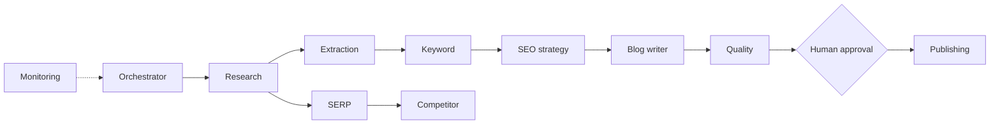

# Agent and workflow design

## Status
Agent classes and workflow modules are interfaces/placeholders only. No
LangGraph graph is currently compiled or executed.

Agents extend `agents.base.BaseAgent` and are typed against `app/schemas`. The
workflow builders (`research_workflow`, `seo_content_workflow`) define state
`TypedDict`s and raise `NotImplementedError`.

## Roles
- Research orchestrator: validates scope and coordinates workflow state.
- Research/SERP/competitor agents: gather source-backed market context.
- Extraction agent: converts content to candidate entities and claims.
- Keyword and SEO strategy agents: derive evidence-backed opportunities.
- Blog writer: drafts from approved briefs and sources.
- Quality agent: checks facts, editorial requirements, and on-page criteria.
- Publishing and monitoring agents: gated WordPress and Search Console tasks.

## Design principles
Use bounded inputs/outputs and typed state; keep providers in tools/adapters;
pass source identifiers with every factual result; separate generation from
verification; and require approval for external side effects. An LLM's response
is a proposal, not proof.

## Future workflow checkpoints
1. Accept request and scope.
2. Discover sources and capture provenance.
3. Extract facts and entities.
4. Analyze SERPs, competitors, and keywords.
5. Retrieve graph/vector context for synthesis.
6. Verify claims and produce a cited report.
7. Optionally draft SEO content and quality-review it.
8. Wait for explicit approval before publication.

Every step should expose status, inputs/outputs, elapsed time, retries, and
actionable errors. Checkpointing and human review should be added before
long-running or costly workflows.
