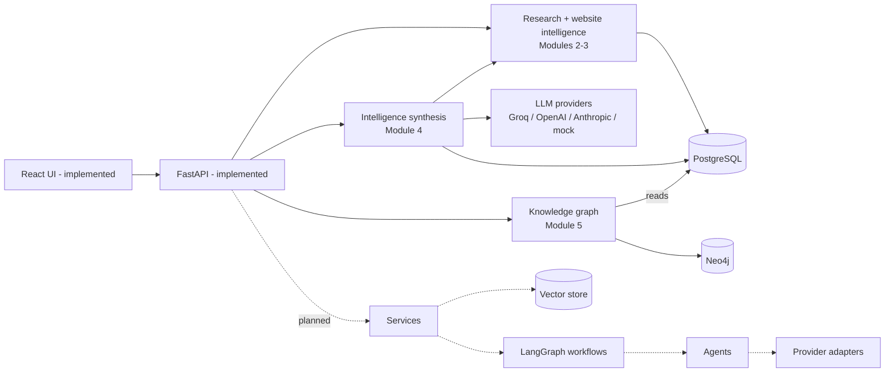

# AURORA system architecture

## Status
This document describes the intended architecture. **Implemented (Modules 1-2):**
the FastAPI app, settings, logging, exceptions, schemas, the React dashboard
scaffold, and the web research engine (SerpApi search, URL/SSRF policy, Firecrawl
extraction, PostgreSQL persistence; see `research-engine.md`).
**Module 3:** website intelligence (`website-intelligence-engine.md`).
**Module 4:** LLM provider layer (`llm/`) and the synchronous intelligence synthesis
engine (`intelligence/`): context builder → bounded reasoning with controlled follow-up
research through Module 3 → synthesis → cited report → quality gates
(`llm-provider-architecture.md`, `research-context-builder.md`,
`intelligence-reasoning-engine.md`, `multi-source-synthesis.md`, `report-generation.md`,
`research-quality-evaluation.md`). LLM output is a validated proposal; every factual
statement must cite stored evidence. Evidence budgets are resolved per provider
(`Settings.context_budget_for`), so a low-limit provider such as Groq gets a smaller context.
**Module 5:** knowledge graph (`knowledge-graph-architecture.md`): Neo4j as a derived,
evidence-backed projection of PostgreSQL research, synchronized through an idempotent outbox.
**Not implemented:** agents/LangGraph workflows, vector/GraphRAG retrieval,
publishing, and monitoring; those modules are importable skeletons that raise
`NotImplementedError` or `ConfigurationException`.

Solid arrows exist today; dotted arrows are planned.

## Logical components
1. **Web application:** React/TypeScript dashboard for research requests,
   reports, content briefs, and approval workflows.
2. **API:** FastAPI handles validation, authorization, lifecycle operations,
   and stable versioned contracts.
3. **Application services:** research and SEO services coordinate domain rules
   and injected repositories/adapters.
4. **Agent workflows:** LangGraph coordinates bounded tasks and typed state;
   agents should be small role-specific components, not direct infrastructure
   owners.
5. **Provider adapters:** Firecrawl, SERP, Anthropic, Groq, WordPress, and
   Search Console clients isolate vendor behavior and credentials.
6. **Persistence/retrieval:** PostgreSQL stores operational records, Neo4j
   models sourced entities and relationships, and a vector store indexes
   source-linked passages.

## Intended request flow
The UI submits a topic to the API. The API validates it and creates a durable
research job. A workflow coordinates source discovery, retrieval, extraction,
analysis, verification, and report generation. Persisted findings retain
source references. Content drafting and publishing are separate, approval-gated
flows. Monitoring reads authorized Search Console data on a scheduled basis.

## Boundaries and reliability
- API routes should remain thin; domain services own business coordination.
- Provider clients should be injected, configured by environment, bounded by
  timeouts/rate limits, and testable without network calls.
- Workflows should expose typed state, retries for transient errors, and
  observable step failures; do not retry unsafe writes without idempotency.
- External web text is untrusted. SSRF controls, prompt-injection defenses,
  access policies, and provenance are required before crawling is implemented.
- Publication must require explicit human approval.

## Structural corrections
- The supplied tree labels Python package initializers as `init.py`. They are
  created as `__init__.py`, the name Python uses for package initialization;
  otherwise imports such as `app.api.routes` would not have the expected
  package structure.
- Python modules are imported from the `backend` source root (`app.*`), configured
  through `PYTHONPATH=backend` for local execution and the container.
- Frontend TypeScript project references use app/node tsconfigs compatible with
  Vite 6. This adds the required referenced configuration files.
- The frontend and backend have separate environment examples to keep browser
  configuration distinct from server-only secrets.

## Deployment shape
Docker Compose defines an API, PostgreSQL, and Neo4j with health checks and
persistent local volumes. It is a development topology, not a production
deployment: production requires managed secrets, TLS, backups, network policy,
resource limits, migrations, monitoring, and hardened authentication.
