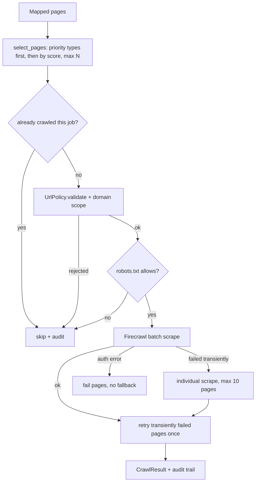

# Mapping, classification and crawling strategy

## Website mapping (`website_mapper.py`)

`WebsiteMapper.map(url, query)` validates the site URL (full DNS-aware
`UrlPolicy.validate`), calls Firecrawl `POST /v1/map` (`limit`, optional
`search`), and turns every returned link into a `MappedPage`:

1. strip tracking parameters (`utm_*`, `gclid`, `fbclid`, ...), normalize
   (`UrlPolicy.normalize`), deduplicate;
2. confine to the website (`same_site`: the registrable domain, so subdomains such
   as `docs.acme.com` are in scope, other sites are `outside_website_scope`);
3. validate each distinct host once with DNS (a subdomain resolving to a private
   address is excluded as `url_rejected:blocked_ip`);
4. classify, score and apply exclusion rules.

Excluded pages are **kept** with `exclusion_reason` for audit. Exclusions:
non-HTML assets (`.pdf`, images, `.js`, ...), authentication/account pages,
cart/checkout, admin paths, feeds, tag/category/author archives, pagination, and
`exceeds_max_depth` (URL path segments > `WEBSITE_RESEARCH_MAX_CRAWL_DEPTH`).
`WEBSITE_RESEARCH_MAX_MAP_URLS` caps the number of links requested.

## Page classification

`RuleBasedPageClassifier` is deterministic: homepage (empty path), then keyword
match on URL path tokens in priority order, then host (`docs.`, `api.`), then
the page title. Types: homepage, about, company, product, service, pricing,
features, documentation, api_documentation, blog, case_study, customer_story,
integrations, security, careers, contact, unknown. The `PageClassifier` protocol
(`classify(url, title) -> PageType`) lets an LLM classifier be injected later; no
LLM is called today.

## Relevance score (0-1)

`type weight` (pricing/product 0.9, service/features 0.85, homepage 0.8,
documentation 0.7, ..., careers 0.1) `+ 0.15 x` overlap with the query terms in
the URL/title `- 0.05 x (depth - 1)`.

## Crawling (`intelligent_crawler.py`)

* **Selection**: guarantees the best homepage, pricing, product, features,
  service, about and documentation pages first, then fills by relevance up to
  `min(max_pages, WEBSITE_RESEARCH_MAX_PAGES_PER_SITE)`. The all-in-one run also
  splits `WEBSITE_RESEARCH_MAX_TOTAL_PAGES` evenly across websites.
* **Revalidation**: every URL is validated again right before submission
  (DNS-aware) and must stay on the website's domain. Fallbacks cannot bypass it
  because they only receive URLs that passed.
* **robots.txt**: a best-effort pre-filter using AURORA's own user agent
  (`AuroraResearchBot`) via `RobotsChecker`; the robots URL itself is validated,
  redirects are not followed, a missing/unreachable file allows crawling. This is
  not a guarantee of Firecrawl's behaviour.
* **Batch + fallback**: `POST /v1/batch/scrape` in chunks of 25, polled
  (`WEBSITE_RESEARCH_BATCH_POLL_SECONDS` x `_BATCH_MAX_POLLS`). Only results whose
  `sourceURL` matches a requested URL are accepted. Transient failure -> up to 10
  individual scrapes (bounded concurrency `WEBSITE_RESEARCH_MAX_CONCURRENT_PAGES`);
  authentication/configuration failure -> no fallback.
* **Retry**: one extra round for pages that failed with `provider_unavailable`,
  `provider_rate_limited` or `missing_from_batch`.
* **Status**: `completed`, `partial`, `failed`, `empty`; counts for requested,
  processed, successful, failed and skipped pages; per-page `attempts`/`method`.
* **Audit trail** (`CrawlResult.audit`): `selected`, `scraped`, `failed`,
  `retried`, `skipped`, `robots_blocked`, each with URL, time and reason. Every
  attempted URL is also stored as a `research_sources` row with its outcome.

Not done: provider `crawl` API, recursive crawling, JavaScript/authenticated
pages, paywalls/CAPTCHAs (never bypassed), per-domain rate limiting beyond
Firecrawl's own limits and the bounded concurrency.

## Content processing (`content_processor.py`)

Input: successful pages. Output: `ProcessedDocument` (original Markdown kept
unchanged next to `normalized_markdown`, hashes of both, sections, metadata,
`status` processed/empty/duplicate).

* Removes zero-width characters, collapses blank lines, drops cookie/consent and
  "skip to content"/copyright lines, link-only navigation runs at the top and
  bottom of a page, and lines repeated on >= 60% of a site's pages (min 3 pages).
* Preserves headings, tables, lists and fenced code blocks (nothing inside a
  code fence is touched).
* Canonical URL only if the provider supplies one *and* it passes URL policy and
  is on the same site; publication/modification dates only if they look like
  ISO dates in provider metadata. Nothing is guessed.
* Content larger than `WEBSITE_RESEARCH_MAX_CONTENT_SIZE_MB` is truncated
  (`truncated=true`); sections over 6000 characters are split by paragraph, each
  keeping its heading and order.
* Duplicate content (same normalized hash) is marked `duplicate` with
  `duplicate_of`.
