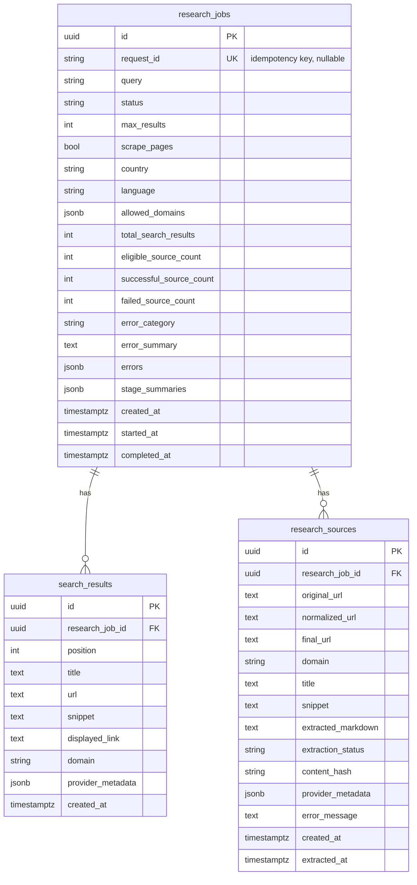
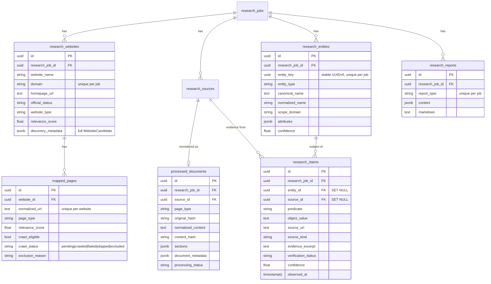

# Database design

## Status
**PostgreSQL (Module 2) is implemented** for the research engine: SQLAlchemy 2.x
async models, an Alembic migration, and a repository. **Neo4j and the vector
store are not implemented** (`Neo4jClient.connect` raises). The API starts
without any database; a database is only needed when a research request is
made. Missing/unreachable databases yield `503 persistence_error`.

## Implemented schema (research engine)



* Foreign keys are `NOT NULL` with `ON DELETE CASCADE`: a source cannot exist
  without its job.
* `UNIQUE (research_job_id, normalized_url)` prevents duplicate sources in a job
  (rejected URLs with no normalized form are exempt: PostgreSQL treats NULLs as
  distinct).
* Indexes: job `status`, `created_at`; child `research_job_id`; `domain`;
  source `normalized_url`, `content_hash`, `extraction_status`.
* Statuses are stored as strings (not PostgreSQL enums) so adding a status needs
  no enum migration; the application validates them.
* `content_hash` is a SHA-256 of the extracted Markdown, ready for cross-job
  caching. No credentials are ever stored.
* The job row is inserted (`running`) before provider calls; search results,
  sources and the final job state are then written in **one transaction**.

## Connection lifecycle
`database/session.py` creates the async engine lazily (first request), with
`pool_pre_ping`, pool limits and a connect timeout; it is disposed in the
FastAPI lifespan shutdown. Repositories translate driver errors into
`PersistenceException` with a safe message.

## Migrations (Alembic)
Configuration: `alembic.ini` + `backend/migrations/`. The URL comes from
`DATABASE_URL`. Run from the repository root with `PYTHONPATH=backend`:

```powershell
$env:PYTHONPATH = "backend"
alembic upgrade head                                        # apply
alembic downgrade -1                                        # roll back one step (drops tables!)
alembic revision -m "describe change"                       # new empty revision
alembic revision --autogenerate -m "describe change"        # compare models to a live DB
alembic upgrade head --sql                                  # print SQL, no connection
alembic current; alembic history
```
Migrations are never run automatically. `downgrade` drops tables and their data.

## Further PostgreSQL tables (planned)
Operational relational data should additionally include:
- `findings`: normalized claim/text, confidence, and source references.
- `keyword_clusters`, `content_briefs`, and `content_drafts`.
- `audit_events`: actor, action, target, timestamp, and approval state.

Use UUID identifiers, UTC timestamps, explicit lifecycle enums, foreign keys,
unique constraints for idempotency, and migrations. Keep large raw source
payloads in controlled object storage when required rather than unbounded rows.

## Neo4j
See [knowledge-graph-schema.md](./knowledge-graph-schema.md) for node and
relationship conventions.

## Vector storage
ChromaDB is the initial dependency choice for a local vector-store adapter.
Store embeddings with chunk/source IDs and metadata; do not treat vectors as a
system of record. Re-index from canonical source records when embeddings or
chunk policies change.

## Security and operations
Use separate least-privilege credentials, TLS in production, encrypted
backups, retention limits, and migration review. Never commit credentials.
Database startup must be explicit; importing the API must not require running
databases.

## Module 3 schema (migration `0002`, additive)



* `research_jobs.job_type` (`research` default, `intelligence`) is the only change
  to a Module 2 table; existing rows keep `research`. Module 3 reuses
  `research_sources` (the original extracted Markdown lives there) and
  `search_results` (raw discovery results).
* A processed document's *original content reference* is its `source_id` plus
  `original_hash`; the normalized text is stored on the document.
* `research_entities.id` is per job; `entity_key` is the stable cross-run id
  exposed by the API.
* The migration only creates objects and adds one defaulted column. Its downgrade
  drops only Module 3 objects (verified from generated SQL; run against a live
  PostgreSQL only via the opt-in integration tests).
* Commands: `alembic upgrade head`, `alembic downgrade 0001` (drops Module 3 data
  only), `alembic upgrade head --sql` (print SQL, no connection).
