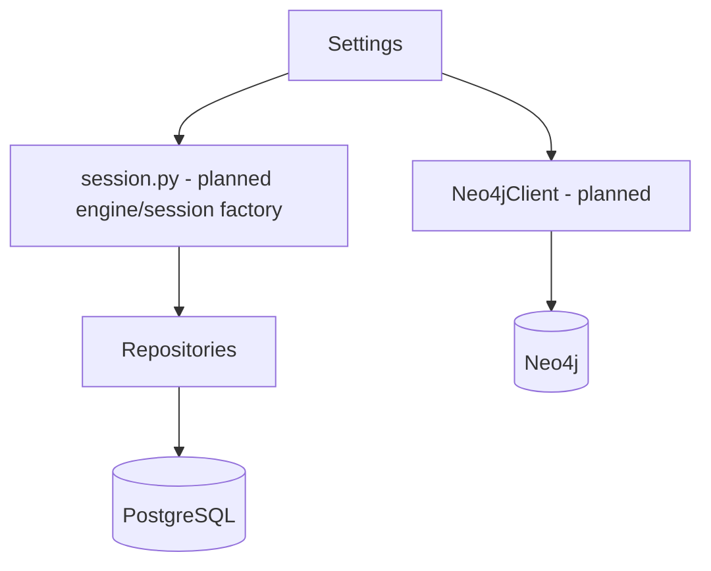

# Database design

## Status
PostgreSQL and Neo4j are represented in local Compose configuration. Present in
code: `Settings.database_url`/`neo4j_*` (secrets masked), `database/models.py`
(SQLAlchemy `Base` only), `database/session.py` (`get_database_url`;
`create_session_factory` raises `NotImplementedError`), `ResearchRepository`
(placeholder) and `Neo4jClient` (`connect` raises). No tables, migrations,
connections, or graph persistence exist, and the API starts without either
database.

Connection lifecycle (planned): create engine/driver explicitly in the FastAPI
lifespan or on demand, with pool limits and timeouts; dispose on shutdown;
readiness checks separate from the liveness endpoint.

## PostgreSQL (planned)
Operational relational data should include:
- `research_jobs`: request scope, state, timestamps, and failure summary.
- `sources`: canonical URL, source type, retrieval metadata, and content hash.
- `findings`: normalized claim/text, confidence, and source references.
- `keyword_clusters`, `content_briefs`, and `content_drafts`.
- `audit_events`: actor, action, target, timestamp, and approval state.

Use UUID identifiers, UTC timestamps, explicit lifecycle enums, foreign keys,
unique constraints for idempotency, and migrations. Keep large raw source
payloads in controlled object storage when required rather than unbounded rows.

## Neo4j
See [knowledge-graph-schema.md](./knowledge-graph-schema.md) for node and
relationship conventions.

## Vector storage
ChromaDB is the initial dependency choice for a local vector-store adapter.
Store embeddings with chunk/source IDs and metadata; do not treat vectors as a
system of record. Re-index from canonical source records when embeddings or
chunk policies change.

## Security and operations
Use separate least-privilege credentials, TLS in production, encrypted
backups, retention limits, and migration review. Never commit credentials.
Database startup must be explicit; importing the API must not require running
databases.
