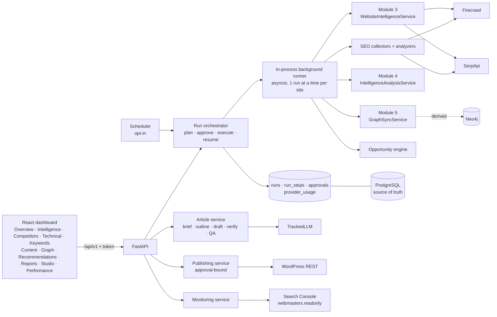

# AURORA final product — architecture audit and implementation plan

**Status:** proposal for review (2026-10-31). Nothing in this document is implemented. Decisions
that need approval are collected in §9. This plan takes over the scope of the planned Modules 6–8
and is built as one product. It reuses `docs/module-6-design.md` where that design still fits and
changes it where the product scope differs (§3.3).

---

## 1. Audit: what exists today (verified in code)

### 1.1 Working engines (Modules 1–5)

| Capability | Code | Facts that matter for the product |
| --- | --- | --- |
| Web research | `research/research_service.py`, `POST /research` | SerpApi search + Firecrawl scrape, synchronous. The only endpoint with idempotency (client `request_id`). Persists once at the end. |
| Website intelligence | `research/website_intelligence_service.py` (`discover`, `map_website`, `crawl_website`, `run`) | Discovery (≤12 queries), Firecrawl map + batch scrape, deterministic extraction (regex/heading rules) into company/product/service/technology/pricing/feature claims with verbatim excerpts. Persists per site as it goes, so partial results survive. Status commits per phase, but stage timings are written only at the end. |
| SEO page data captured | `tools/firecrawl_tool.py` (`formats:["markdown"]`, `onlyMainContent:true`) | Title, meta description, target status code, canonical, language, OG site/url, published/modified, headings (as Markdown sections). **Not captured:** raw HTML, robots meta, X-Robots-Tag, response headers, redirect chains, links/outlinks, JSON-LD, hreflang, image alt, sitemap parsing. |
| SERP data | `tools/serpapi_tool.py` `_parse` | **Organic results only.** No PAA, related searches, featured snippet, AI Overview, local pack, ads or shopping. No device/location/pagination parameters. |
| AI synthesis | `intelligence/service.py` (`POST /intelligence/analyze`) | Context → bounded reasoning → synthesis → cited report → quality gates, all through `TrackedLLM` with call/token/cost budgets. Default provider is `mock`. Anthropic and Groq providers exist (SDKs installed) but have only been verified with mocks. `openai` is not installed. |
| Knowledge graph | `graph/*`, `/graph/*` (~30 routes) | Outbox sync PostgreSQL → Neo4j (MERGE by stable id), query service, provenance. Sync is never triggered automatically after research. **Module 5 is uncommitted in the working tree** (new files are untracked). |
| Usage and cost | `llm/usage_tracker.py`, `llm_usage_records` | LLM usage is persisted, but only for Module 4 analyses (`analysis_id` NOT NULL). SerpApi/Firecrawl requests are counted in memory per run and **never persisted**. No credit tracking. |
| Provider protection | `tools/http.py`, `core/concurrency.py`, `core/metrics.py` | Retries with jitter, `Retry-After`, a circuit breaker, process-wide concurrency gates, and a per-run request budget (only active in `WebsiteIntelligenceService.run`). |
| Reports | `research/research_report.py`, `intelligence/report_generator.py` | JSON + Markdown. `PdfExporter` raises `ConfigurationException`. **No PDF.** |

### 1.2 Skeletons (raise `NotImplementedError` / `ConfigurationException`)
- **Domain packages:** every class in `agents/*`, `workflows/*` (no LangGraph import anywhere),
  `seo/*` (5 files), `rag/*`, `publishing/wordpress_publisher.py` and `monitoring/search_console.py`.
- **Tools:** `tools/wordpress_tool.py`, `tools/search_console_tool.py`, `tools/claude_tool.py` and
  `tools/groq_tool.py` are skeletons. The real LLM code lives in `llm/`.
- **Schemas:** `schemas/content.py` (`ContentBrief`, `BlogArticle`, `ContentQualityReport`) and
  `schemas/seo.py` (`KeywordInfo` with nullable metrics) are real Pydantic but minimal.

### 1.3 Missing infrastructure

| Area | Today |
| --- | --- |
| API authentication | None. Every route is open. No CORS (the Vite proxy makes it unnecessary locally). No inbound rate limiting. |
| Background execution | None. Every POST runs the whole job inside the request, so a multi-minute "Analyze" cannot show live progress or survive a browser timeout. |
| Scheduler | None. |
| Health | `GET /health` is liveness only. `GET /graph/health` probes Neo4j. There is no database or readiness check. |
| Validation errors | FastAPI's default 422 `{"detail": [...]}` is not in the `{"error": …}` envelope, and the frontend does not parse it. |
| Frontend | One page (`DashboardPage.tsx`) calling `POST /research`. React 19 + Tailwind 4 only: no router, charts, data-fetching or Markdown library. The custom CSS uses hard-coded colours and no dark mode. |
| Startup | No start script. The setup is 8 manual steps. The API container has never been built or run (`setup-guide.md`). |

### 1.4 What is reusable without change
- `UrlPolicy` / `SourceManager` and `RobotsChecker`.
- The `tools/http.py` retry/breaker/bounded-send stack and the `ExternalTool` base.
- The Module 3 pipeline and its partial-result persistence.
- The Module 4 pipeline and its evidence-id validation pattern.
- `TrackedLLM` and pricing.
- The graph query/provenance services.
- `prompts/extraction_prompts.py` (untrusted-content wrapping).

---

## 2. Feature → code map

Legend: **R** reuse as-is · **E** extend existing code additively · **N** new code.

| Requested feature (Part) | Existing code | Work |
| --- | --- | --- |
| One-click Analyze + progress, partial results, retries, budgets (P2) | Module 3 `run`, Module 4 `analyze`, graph `sync_job` | **N** run orchestrator + step ledger + background runner; **R** the engines as steps |
| Website overview / intelligence (P3 A–B) | `/research/{job}/websites\|entities\|claims\|report` | **R** data; **N** dashboard views, overview aggregation |
| Competitor intelligence (P3 C) | Module 3 discovery (`target_names`, official status), graph `COMPETES_WITH` | **E** competitor discovery from SERP overlap; **R** graph facts vs inferred |
| Technical SEO (P3 D) | Firecrawl adapter, `UrlPolicy.trace_redirects`, robots | **E** `scrape_for_seo` (rawHtml + links), header capture; **N** HTML/JSON-LD/sitemap parsing + analyzers |
| Keyword intelligence (P3 E) | SerpApi organic parser, `schemas/seo.py` | **E** `search_serp` full-SERP parser; **N** keywords, clustering, intent rules |
| Content intelligence (P3 F) | `processed_documents.sections` | **N** inventory, gap, cannibalization, internal links, refresh analyzers |
| Knowledge graph view (P3 G) | `/graph/*` (verified vs inferred already separated) | **R** API; **N** UI; **E** auto-sync step when Neo4j is configured |
| Recommendations (P3 H) | — | **N** rubric engine (Module 6 design §5.5, no numeric scores) |
| Reports (P3 I) | Module 3 + Module 4 reports (JSON/MD) | **E** combined site report; PDF stays unavailable (D9) |
| Blog opportunities (P4) | — | **N** opportunity engine over keywords + gaps + GSC + graph |
| Article generation (P5) | `TrackedLLM`, Module 4 evidence validation, Module 2 research for sources | **N** article pipeline, versioned prompts, claim verification, quality checks |
| Content Studio + approval (P6) | `schemas/content.py` `ArticleStatus` | **N** versions, section regeneration, hash-bound approvals |
| WordPress publishing (P7) | `tools/wordpress_tool.py` skeleton, settings already exist | **N** adapter, publication ledger, idempotency |
| Search Console monitoring (P8) | `tools/search_console_tool.py` skeleton, Google settings exist | **N** OAuth read-only connector, performance store, analyzers |
| Feedback loop (P9) | — | **N** rules over GSC + run diffs → recommendations / refresh drafts |
| Scheduling (P10) | — | **N** minimal in-process scheduler over a `schedules` table |
| Security (P11) | SSRF, injection wrapping, secret redaction | **N** API token auth, audit log, rate limit, retention; **E** error envelope |
| One-command start (P12) | compose for postgres/neo4j | **N** `start-aurora.ps1`, readiness endpoint |

---

## 3. Target architecture

### 3.1 Orchestration: one run, many steps
- **Runs:** "Analyze" creates a `run` with a step plan:
  - register
  - map + crawl (Module 3)
  - SEO page collection
  - robots/sitemap
  - SERP research
  - technical audit
  - keywords + clusters
  - competitors
  - content gap
  - AI synthesis (Module 4)
  - graph sync (when configured)
  - recommendations
  - opportunities
  - report
- **Steps:**
  - Each step is idempotent. Writes are keyed by (`run_id`, natural key), and a step's existing
    outputs are reused on resume.
  - Each step records status, attempts, error category and usage.
  - A failed step makes its dependents `skipped` / `not_available`, never guessed.
- **Engine:** a PostgreSQL step-ledger executor (Module 6 design D2), not LangGraph. It needs no
  new dependency, and approvals survive restarts.
- **Background runner (D2):**
  - An in-process asyncio task started by the API after the run is approved.
  - The dashboard polls `GET /runs/{id}` every 2 s.
  - One active run per site, enforced by a DB constraint.
  - If the process stops, the run stays `running` with a heartbeat. On the next request it is shown
    as `interrupted`, and the user clicks **Resume**. There is no automatic re-execution, so no
    credits are spent silently.
  - Nothing touches the database at import or startup.
- **Budget gate:**
  - Before execution the plan shows estimated units per provider (searches, scrapes, LLM tokens,
    estimated cost when priced).
  - The user approves a ceiling. The default URL-only analysis has a small preset (D4).
  - Every provider call reserves units. When the budget is exhausted the step stops, its dependents
    are skipped, and the run ends `partially_completed`.

### 3.2 Evidence states (everywhere)
- **States:** `measured` (GSC, DataForSEO), `observed` (crawl, SERP at a timestamp/location),
  `inferred` (deterministic rules), `hypothesis` (any LLM-origin content).
- **Rules:**
  - Search volume, difficulty, CPC and traffic appear only when a provider row exists. Otherwise they
    show as "not available".
  - No numeric SEO scores, anywhere.

### 3.3 Changes to the Module 6 design
1. **Skill registry deferred (D7).** Analyzer rules are implemented from the bound skills with a
   static `skill_ref` constant per rule. The runtime `.claude/skills` parser, safety scanner,
   selection API and LLM guidance excerpts are dropped from this scope. That removes about 8 routes
   and a test-heavy component with no user-visible value.
2. **Background runner instead of synchronous runs**, because one-click Analyze needs live progress.
3. **External writes now in scope**, but only WordPress, and only through the approval ledger. No
   sitemap submission, Indexing API, IndexNow or disavow.
4. **Usage table** is `provider_usage` for all providers, including SerpApi/Firecrawl, which are
   currently unpersisted. Module 4's `llm_usage_records` stays untouched.

---

## 4. Database changes (additive migrations only; no Module 1–5 table altered)

| Migration | Tables | Notes |
| --- | --- | --- |
| `0005_sites_runs` | `sites`, `runs`, `run_steps`, `approvals`, `provider_usage`, `audit_log` | `sites.domain` UNIQUE. Partial unique index: one `running` run per site. `run_steps` UNIQUE(`run_id`, `step_key`). Runs link to the Module 3 `research_job_id` and Module 4 `analysis_id` (SET NULL). |
| `0006_seo_observations` | `seo_page_snapshots`, `seo_page_links`, `seo_serp_snapshots`, `seo_serp_results`, `seo_keywords`, `seo_keyword_metrics`, `seo_keyword_clusters`, `seo_findings`, `seo_recommendations`, `seo_recommendation_events` | As in Module 6 design §4. Raw HTML is not stored, only signals + hash (D8 there). |
| `0007_content` | `content_opportunities`, `articles`, `article_versions`, `article_sections`, `article_sources`, `article_quality_reports` | Versions are immutable. `content_hash` = sha256 of canonical (title, slug, meta, body, schema, settings). Each section is regenerable (new version). |
| `0008_publishing_monitoring` | `cms_destinations` (no secrets: names the env-configured credential), `publication_approvals`, `publications`, `search_performance`, `url_inspections`, `schedules` | Approval binds `article_version_id` + `content_hash` + `destination_id` + slug + settings hash. `publications` UNIQUE(`approval_id`) gives idempotent publishing. `search_performance` UNIQUE(site, date, query, page, country, device, type). |

Retention (Part 11): `audit_log` and `provider_usage` are kept. A manual
`scripts/retention.py --older-than` (dry-run by default) prunes snapshots. Nothing is automatic.

---

## 5. API and frontend changes

### 5.1 API (`/api/v1`, new routers; existing routes unchanged)
- **Auth (D3):** `AURORA_API_TOKEN` is a bearer token required on every non-health route.
  - If it is unset, the API refuses write routes with a clear message, so it still starts without
    credentials.
  - The backend binds to `127.0.0.1` by default.
  - Inbound rate limiting uses a small in-process token bucket on write routes (no dependency).
- **Routes:**
  - `sites`: CRUD.
  - `runs`: plan, approve, execute, resume, cancel, steps, usage.
  - `sites/{id}/overview|technical|keywords|competitors|content|recommendations|graph|report`.
  - `opportunities`.
  - `articles`: generate, versions, sections/{key}/regenerate, edit, quality, preview.
  - `articles/{id}/approvals`.
  - `publications`.
  - `destinations`: read and test-connection.
  - `performance`: GSC sync and queries.
  - `schedules`.
  - `connectors`: which providers are configured, with no live calls.
  - `health/ready`: DB, migrations at head, graph status, configured providers.
- **Errors:** a `RequestValidationError` handler returns the existing `{"error": …}` envelope.

### 5.2 Frontend
- **Shell:** sidebar app with a site switcher.
- **Views:**
  - Analyze (URL plus optional fields, plan + estimate, approve)
  - Run progress (step ledger)
  - The nine dashboard sections A–I
  - Content Studio (opportunities → article editor with section regenerate, preview, quality
    report, evidence panel, SEO checklist, publishing settings, approve, publish)
  - Performance (GSC tables + SVG trend lines)
  - Settings (connectors, schedules, budgets)
- **Design:** design tokens with light and dark mode, responsive, every API failure visible.
- **Dependencies (D5):** recommended: `react-router` (≈12 views make state-based navigation
  painful) and `dompurify` for the preview. Markdown → HTML is rendered and sanitized on the
  backend. Charts are hand-written SVG (no chart library).

---

## 6. Integrations

| Integration | Design | Status / your setup |
| --- | --- | --- |
| Firecrawl | **E** `scrape_for_seo`: `["markdown","rawHtml","links"]`, `onlyMainContent:false`; signals extracted, HTML discarded | Existing key. Raw HTML formats may cost more credits per scrape; check your plan |
| SerpApi | **E** `search_serp(query, country, language, location, device)` → SERP features + organic | Existing key. 1 search credit per SERP |
| LLM (article + synthesis) | `TrackedLLM` only; Anthropic for article quality (D6), Groq as a cheap option, mock in tests | Live calls need your approval and a key. TEST 2 requires `ANTHROPIC_API_KEY` |
| WordPress | REST API + Application Passwords over HTTPS. Create as `draft` → publish only with a matching approval → returns post id/URL. Featured image via `/wp/v2/media`. Categories/tags by id lookup/create. SEO title/description through Yoast/Rank Math only if the plugin exposes REST-writable meta; otherwise stored and reported as "set manually". No delete. Updating a published post needs a separate approval | WordPress site, a user with an Application Password, HTTPS. Credentials in `.env` only, never the frontend |
| Search Console | HTTPX + OAuth refresh token, scope `webmasters.readonly`, `sites.list` permission check, Search Analytics (paged), URL Inspection (quota-bounded). A local `scripts/gsc_authorize.py` performs the one-time loopback OAuth and prints the refresh token for you to put in `.env` yourself | Google Cloud project, Search Console API enabled, OAuth desktop client, verified property |
| DataForSEO | Adapter with a mocked test only; `DATAFORSEO_ENABLED=false`; per-run approval; provider-reported cost recorded | Paid account; stays off |
| Neo4j | Optional graph sync step when `NEO4J_PASSWORD` is set; the PostgreSQL fallback serves the graph view otherwise | Optional |

### 6.1 Article pipeline (Part 5)
1. Brief from the opportunity (keyword, intent, audience, gaps, competitor coverage).
2. Source research through the existing Module 2 `ResearchService` (bounded; results become
   `article_sources` with excerpts).
3. Competitor article analysis from stored SERP + scraped sections (headings and topics only;
   competitor text is never copied).
4. Outline (LLM, strict schema).
5. Section-by-section draft (LLM). Every factual sentence cites a source id.
6. Verification:
   - Citations must reference provided source ids and an excerpt that exists in the stored source.
   - Numbers must appear in the cited evidence.
   - Failing sentences are removed or flagged.
7. SEO package:
   - title, meta, slug
   - headings
   - internal links (only URLs from the site's crawled inventory)
   - external references (only researched sources)
   - FAQ only when PAA questions were observed
   - JSON-LD (`Article`/`BlogPosting`, `FAQPage` noted as not eligible for rich results)
   - featured-image brief
8. Deterministic quality checks:
   - link validity (same `UrlPolicy`)
   - keyword density bounds
   - duplicate-phrase overlap against competitor sections (n-gram)
   - readability formula
   - title/meta lengths
   - schema validation
   - unsupported-claim count
   - filler-phrase list
9. Optional LLM review, labelled as a hypothesis.

"Passed" means "evidence-backed and well-formed", never "will rank".

---

## 7. Phases (incremental; each ends with green tests, ruff, frontend build and a checkpoint report)

| Phase | Scope | Unlocks | Complexity | Main risk |
| --- | --- | --- | --- | --- |
| **0. Baseline** | Commit Module 5 (with your approval). Validation-error envelope. `/health/ready`. API token auth + rate limit. `start-aurora.ps1` (prereq checks, compose up postgres [+neo4j], wait healthy, migration check, start uvicorn + vite, open browser) | TEST 8 | S | Docker Desktop/WSL differences on your machine |
| **1. Orchestrator + dashboard shell** | Migration 0005. Sites/runs/steps/approvals/usage. Background runner, plan/estimate/approve/resume. Steps wrapping Module 3, Module 4 and graph sync. Persisted SerpApi/Firecrawl usage. New frontend shell, Analyze, progress, Overview, Website Intelligence, Graph, Reports | TEST 1, TEST 2 (mock) | L | Wrapping Module 3/4 inside steps without changing their behaviour; long-running tasks in the API process |
| **2. Technical SEO** | `scrape_for_seo`, header capture, robots/sitemap fetch + defused XML, HTML/JSON-LD parsing, migration 0006, technical/schema/internal-link analyzers, recommendation engine, Technical + Recommendations views | TEST 3 | L | Firecrawl rawHtml credit cost; parser edge cases |
| **3. Keywords, competitors, opportunities** | `search_serp`, keyword expansion (PAA/related/organic titles), SERP-overlap clustering, intent rules, SERP-competitor vs business-competitor separation, content inventory/gap/cannibalization (SERP mode), opportunity engine, Keywords/Competitors/Content views | TEST 4 | L | SerpApi credit use (bounded per run); usefulness without volume data |
| **4. Article generation + Content Studio** | Migration 0007. Article pipeline (§6.1), versioned prompts, verification, quality checks, section regenerate, editor/preview (sanitized), hash-bound approvals | TEST 5 | XL | LLM output quality and cost; this is where the product succeeds or fails |
| **5. WordPress publishing** | Migration 0008 (publishing part). Adapter, destinations, test connection, draft → approved publish, media, taxonomies, idempotent retry, update-with-approval, audit log | TEST 6 | M | SEO-plugin meta writability varies by plugin |
| **6. Search Console + feedback + scheduling** | GSC connector + authorize script, performance store, article ↔ URL association, analyzers (low CTR, falling clicks, declining position, new queries, cannibalization in GSC mode, not indexed), improvement recommendations + refresh drafts (approval required), opt-in scheduler with budget envelopes, Performance view, DataForSEO mocked adapter | TEST 7 | L | OAuth setup friction; GSC data lag (2–3 days) means live verification needs a published page with data |
| **7. Hardening + delivery** | Retention script, docs (README, setup, architecture diagram, demo workflow), full test report, controlled live tests (one per provider, after your approval), known limitations | Final report | M | Live-test findings may need fixes |

Phases 2 and 3 can overlap. Phase 4 depends on 3 (opportunities). Phase 6 depends on 5 for
article ↔ URL association, but its site-level GSC part can start after Phase 1.

---

## 8. Acceptance tests and how far each can be verified

| Test | Mocked (offline) | Locally verified | Live verified needs |
| --- | --- | --- | --- |
| 1 URL → Analyze → crawl → intelligence → report | Yes | Yes (Postgres + fakes) | SerpApi + Firecrawl keys, approval, ~1 small run |
| 2 Question → research → Claude synthesis → report | Yes | Yes | `ANTHROPIC_API_KEY` + approval |
| 3 URL → technical audit → recommendations | Yes | Yes (fixture site served locally) | Firecrawl key |
| 4 URL → keywords → SERP/competitors → opportunities | Yes | Yes | SerpApi key (≈10 searches) |
| 5 Opportunity → article → quality → preview | Yes | Yes | LLM key (Anthropic recommended) |
| 6 Approval → WordPress → URL/status | Yes (respx) | Yes against a local WordPress in Docker (optional compose profile, D10) | Your WordPress site + Application Password |
| 7 Published article → GSC → analysis → recommendations | Yes | Fixture data only | GSC OAuth + a property with data for the URL (days after publishing) |
| 8 One-command Windows start | — | Yes on this machine | Docker Desktop running |

A test is reported as live-verified only after a real call succeeded and was recorded. Unit tests
alone do not complete the project.

---

## 9. Decisions needed

| # | Decision | Recommendation |
| --- | --- | --- |
| D1 | Commit the uncommitted Module 5 work before starting (one commit on a `feature/module-5-graph` branch, merged to `main` by you) | Yes: the new work must not be mixed into it |
| D2 | Background execution: in-process asyncio runner + PostgreSQL step ledger, user-triggered resume, vs a separate worker process / queue | In-process runner (single-user local product, no new dependency) |
| D3 | API auth: single bearer token from `AURORA_API_TOKEN`, backend on 127.0.0.1; the frontend gets the token from a login prompt stored in `sessionStorage` (never baked into the bundle) | Yes |
| D4 | Default budget for a URL-only Analyze: 1 site + up to 3 competitors, 25 pages own site, 5 per competitor, 10 SERP searches, LLM synthesis with mock unless a key is configured. Always shown for approval before any credit is spent | Yes, values editable |
| D5 | Frontend dependencies: `react-router`, `dompurify`; backend: `markdown-it-py` (or `markdown`) + `nh3` for sanitized HTML | Yes (smallest set that makes the Studio safe) |
| D6 | LLM for article generation: Anthropic (Claude) primary, Groq fallback for cheap steps; mock in tests | Yes |
| D7 | Defer the Module 6 runtime skill registry; use static `skill_ref` per analyzer rule | Yes |
| D8 | Migrations in `start-aurora.ps1`: check `alembic current` vs head, and if behind, ask "Apply N migrations? [y/N]" (CLAUDE.md: never run automatically) | Yes |
| D9 | PDF reports: not implemented (no approved PDF library); JSON + Markdown only | Yes |
| D10 | Optional `wordpress` compose profile (official `wordpress` + `mariadb` images) for local TEST 6 verification without touching your real site | Yes |
| D11 | Scheduler: in-process, opt-in (`SCHEDULER_ENABLED=false`), each schedule carries a pre-approved unit ceiling; a run over the ceiling waits for approval instead of running | Yes |
| D12 | Update `CLAUDE.md` and the roadmap to describe the merged product scope once Phase 1 lands | Yes |

---

## 10. Known limitations (expected at delivery)
- **Metrics:** no search volume, difficulty or backlink data without DataForSEO (off by default).
  Core Web Vitals stay `not_measured` unless the optional PageSpeed connector is added later.
- **Rendering:** Firecrawl renders JavaScript, but no raw-vs-rendered comparison is done. A
  rendering comparison would need a second fetch path (Playwright, not installed).
- **Rankings:** GSC average position is a weighted average, not a daily rank. GSC data lags
  2–3 days.
- **SEO plugins:** WordPress SEO-plugin fields depend on the plugin exposing REST meta.
- **Quality:** article quality depends on the LLM and the sources found. Every article needs human
  review, and nothing guarantees ranking.
- **Single user:** single-user local deployment. Exposing it on a network needs real user
  accounts, which are out of scope.
