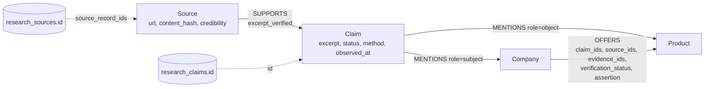

# Graph provenance

- Every stored claim becomes a `Claim` node, including unsupported, unverified and conflicting
  ones. Its status is preserved and never upgraded.
- `SUPPORTS.excerpt_verified` is true only when Module 3 found the excerpt in the stored page
  (supported, partially supported, conflicting).
- Fact relationships carry the **lists** of supporting claims and sources. A second job asserting
  the same fact appends to them; nothing is overwritten.
- Conflicts stay visible: conflicting claims keep `verification_status = conflicting`, the edge gets
  `has_conflict = true`, and Company properties with conflicting values are left empty.
- Full source text stays in PostgreSQL. Graph nodes keep the URL, content hash and the short
  verbatim excerpt (up to 1000 characters).

**Traversal** (`ProvenanceService`; directions are fixed):

| Method | Path |
| --- | --- |
| `claims_for_entity(id)` | `(entity)<-[:MENTIONS]-(claim)` |
| `sources_for_claim(id)` | `(claim)<-[:SUPPORTS]-(source)` |
| `sources_for_entity(id)` | entity <- MENTIONS - claim <- SUPPORTS - source, grouped by source |
| `claims_for_relationship(type, a, b)` | the edge's `claim_ids` -> Claim nodes |
| `conflicting_claims(id)` | claims about the entity with status `conflicting` |
| `evidence_bundle(id)` | claims, sources, verified / unverified counts, conflicts |

A relationship is never treated as verified because it exists. Query results expose
`verification_status`, `assertion`, and `verified` = (status supported or partially supported)
**and** `assertion = direct`.
