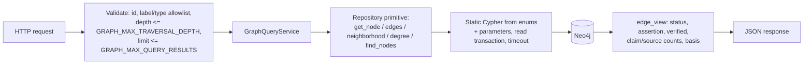

# Graph query guide



All queries are read-only, parameterized and bounded. No endpoint accepts Cypher.

| # | Question | API (`/api/v1/graph`) | Service method |
| --- | --- | --- | --- |
| A | Company profile | `GET /companies/{id}` | `company_profile` |
| B | Products of a company | `GET /companies/{id}/products` | `company_products` |
| C | Services of a company | `GET /companies/{id}/services` | `company_services` |
| D | Technologies of a product | `GET /products/{id}/technologies` | `product_technologies` |
| E | Features of a product | `GET /products/{id}/features` | `product_features` |
| F | Integrations of a product | `GET /products/{id}/integrations` | `product_integrations` |
| G | Competitors | `GET /companies/{id}/competitors`, `/products/{id}/competitors` | `competitors` |
| H | Companies using a technology | `GET /technologies/{id}/companies` | `technology_companies` (direct, plus via owned products) |
| I | Products with a feature | `GET /features/{id}/products` | `feature_products` |
| J | Topics of an article | `GET /articles/{id}/topics` (and `/topics/{id}/articles`) | `article_topics` |
| K | Sources supporting a claim | `GET /claims/{id}/sources` | `claim_sources` |
| L | Claims about a company | `GET /entities/{id}/claims` | `entity_claims` |
| M | Evidence for a product | `GET /entities/{id}/evidence` | `evidence` |
| N | Connected entities (bounded) | `GET /explore?entity_id=&depth=&types=&limit=` | `explore` |
| O | Compare two companies | `GET /companies/{a}/compare/{b}` (products: `/products/{a}/compare/{b}`) | `compare_companies` |

Also available: `GET /entities?label=&name=&domain=`, `GET /entities/{id}` (with degree counts),
`GET /entities/{id}/relationships?direction=&types=&labels=&limit=&offset=`, competitor and
technology networks (`/companies/{id}/network`, `/technologies/{id}/network`), `GET /review`.

**Analytics** (deterministic, documented): shared technologies, integrations, topics and
normalized feature names between two companies or products. Each comes with
`jaccard = |shared| / |union|` and the raw counts. Features are per-website nodes, so they are
compared by normalized name. Degree counts per relationship type. Bounded neighbourhoods for
competitor, technology and product networks. No ranking or "importance" score is computed.

**Reading results:** every related item has `verification_status`, `assertion`, `verified`,
`has_conflict`, `basis`, `claim_count`, `source_count` and `claim_ids`. Treat `assertion=inferred`
(technology mentions as USES, industry-based COMPETES_WITH) as a hypothesis with a stated basis.

**Example**

```http
GET /api/v1/graph/companies/2b1c.../products
-> {"items":[{"relationship":"OFFERS","direction":"out","node":{"id":"…","label":"Product","name":"Acme Flow"},
   "verification_status":"supported","assertion":"direct","verified":true,"claim_count":2,"source_count":2,…}],
   "count":1}
```

Limits: `GRAPH_MAX_QUERY_RESULTS` (default 100) caps every list; `GRAPH_MAX_TRAVERSAL_DEPTH`
(default 3, hard maximum 5) caps `explore`; `NEO4J_QUERY_TIMEOUT_SECONDS` bounds every query on the
server. `explore` reports `truncated: true` when the edge limit was reached.
