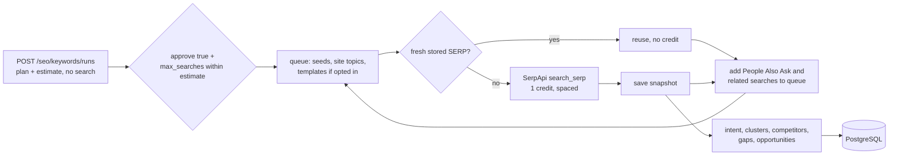

# Keyword intelligence and content opportunities (Phase 3)

AURORA researches keywords from **observed Google results** through SerpApi (the existing provider).
It records each SERP, classifies intent, clusters keywords, finds SERP competitors, detects content
gaps against the site's own stored pages, and ranks content opportunities with their evidence.
Results live in PostgreSQL and on the dashboard's **Keywords** tab.

Code: `backend/app/seo/keywords/`, `backend/app/tools/serpapi_features.py`, API
`backend/app/api/routes/keywords.py`, migration `0006_keyword_research`, UI
`frontend/src/pages/KeywordsPage.tsx`.

## Flow

## What is collected

| Item | Source | Notes |
| --- | --- | --- |
| Organic results (position, domain, title, snippet) | SerpApi `organic_results` | One search per query |
| People Also Ask, related searches | `related_questions`, `related_searches` | Fed back into the queue as long-tail candidates |
| Featured snippet | `answer_box` / `featured_snippet` | Type, text, domain |
| AI Overview | `ai_overview` | `present` only when the response carries text or references. If it carries only a link to a second request, status is `requires_second_request`; AURORA does not make that second paid request and never invents the content |
| Shopping, local, ads | `shopping_results`, `local_results`, `ads` | Presence and counts only |
| Site topics | The site's latest stored **technical audit** (titles, H1/H2) | No network request; none if no audit exists |

Country, language, device and location are stored with every snapshot. A snapshot is one
observation at that time, place and device, not a ranking history.

## Metrics that are not available

SerpApi returns **no search volume, keyword difficulty or CPC**. Every candidate and opportunity
carries them as `{"value": null, "status": "not_available", "source": null}`. They are shown as
"not available", never estimated, and not used in ranking. A metric would be filled only when a
provider that supplies it (for example DataForSEO, which is **not enabled**) returned a value.

## Discovery

Priority: user seeds, then site topics, then queries observed on fetched SERPs (People Also Ask
first, then related searches), then, only when `include_expansions` is on, template variations of
the seeds (`best ... tools`, `how to ...`, `... vs`, `... pricing`, `... alternatives`,
`... examples`). Templates are queries to try, labelled `template`, not measured searches.
Candidates are normalized (NFKC, casefold, punctuation removed) and deduplicated; a run keeps at most
`SEO_KEYWORD_MAX_CANDIDATES`.

## Intent (inferred, with the rule that produced it)

Method: `seo-toolkit-keyword-research`. Rules over the query words, in order:
1. **Navigational:** the query contains the site's brand words.
2. **Transactional:** buy, price/pricing, cost, discount, order, subscribe, trial, download, and similar.
3. **Commercial:** best, top, vs, review, alternative(s), compare, tool(s), software, and similar.
4. **Informational:** starts with how/what/why and similar, or contains guide, tutorial, examples, tips.
5. Otherwise the observed SERP: shopping results suggest transactional; People Also Ask or a
   featured snippet suggest informational.
6. If nothing matches, intent stays **unclassified** (`null`); it is not guessed.

Each classification stores its basis, such as `rule:commercial_term:best`.

## Clusters

Keywords whose top-10 results share **at least 3 URLs** (scheme, `www.` and trailing slash ignored)
are linked; clusters are the connected groups. The cluster key is the shortest member, so it is
stable. Only searched keywords can be clustered.

## Competitors

"SERP competitors" are domains observed in the top 10 of the researched queries, excluding the site
(with or without `www.`), with the keywords and best positions observed. They compete for those
searches; they are not necessarily business competitors. `/competitors/compare` returns a
keyword by domain position matrix for 2 to 10 chosen domains.

## Content gaps

Compared with the site's own **stored audit text** (page titles and headings):
- **Phrases:** adjacent content-word pairs (for example "marketing automation") that appear in the
  titles or snippets of results from at least **2 distinct competitor domains**, are missing from
  the site's text, and do not merely restate the query that produced the result. Each gap lists the
  competitor domains, queries and **verbatim excerpts** with URL and position.
- **Questions:** People Also Ask questions where fewer than 60% of the content words appear in the
  site's text (evidence `inferred`).
- **No audit, no gaps.** Without a stored technical audit the site's content was not read, so the
  status is `site_content_unavailable` and no gap is claimed. Run a technical audit first.

Gaps come from search-result titles and snippets only; competitor pages are not fetched. A gap says
what competitors' results mention that your titles and headings do not. It is not proof that covering
it improves rankings, and matching is lexical (synonyms are not understood).

## Opportunities

One per **searched** keyword. Unsearched candidates have no SERP evidence and no opportunity.

| Action | When |
| --- | --- |
| `write_new` | Site not in the top 10 of the snapshot, and a gap phrase, a gap question or a People Also Ask question was observed |
| `improve_existing` | Site appears at position 4 to 10 |
| `monitor` | Site appears at position 1 to 3 |
| `low_evidence` | No gap and no question observed |
| `deprioritized` | Intent looks transactional or navigational (a product or brand page fits better than an article) |

Ordinal labels:
- **impact:** high with 3 or more supporting gaps/questions, or 1 or more with 3 or more People Also
  Ask; medium with 1 or more gap or 2 or more People Also Ask.
- **confidence:** from organic results observed (8 or more high, 4 to 7 medium), lowered one step if
  the intent is unclassified.
- **effort:** typical values (low for improve/monitor, medium for new). **Risk:** low.
- **order:** action, impact, confidence, supporting-gap count, keyword.

These are planning labels, not forecasts. Each opportunity stores its rationale, a SERP evidence
summary with the snapshot id (open the full SERP via `/serp/{id}`), gap terms and questions.

## Selection for article generation

`POST /opportunities/{id}/selection {"selected": true}` marks an opportunity; `GET /selected` lists
them with their snapshot id, gaps and questions. This only records the choice for the later article
phase. **No article is generated and no LLM is called.**

## Budgets, cache, rate limits, retries, usage

- `SEO_KEYWORD_MAX_QUERIES` (default 10, cap 50) bounds searches per run. The approval ceiling can
  be lower, never higher, than the plan's estimate.
- `SEO_SERP_CACHE_TTL_HOURS` (default 24, 0 disables): a stored snapshot with the same query,
  country, language, device and location inside the TTL is reused for free. Cache hits and fresh
  searches are counted separately, and each opportunity says whether its evidence was cached.
- `SEO_SERP_MIN_INTERVAL_SECONDS` (default 1.0) spaces searches; the adapter's global concurrency
  gate still applies.
- Retries are the adapter's: transient errors (429, 5xx, timeouts) with backoff and `Retry-After`,
  bounded by `RESEARCH_MAX_RETRIES`. A failed query is counted and skipped; three in a row stop the
  run (`provider_failures`). A search is counted only after SerpApi answered.
- Usage per run: searches, cache hits, failures, stop reason, and cost **only if**
  `SEO_SERPAPI_COST_PER_SEARCH` is set; otherwise cost is "not estimated".
- Time limit: `SEO_KEYWORD_MAX_DURATION_SECONDS`.
- Runs are synchronous: the request waits. DataForSEO is not used or enabled.

## Limitations
- SerpApi gives no volume, difficulty or CPC, so opportunities cannot be ranked by demand.
- Intent rules are English keyword rules; other languages fall back to SERP features or stay unclassified.
- Gap detection reads titles and snippets of results, not competitor pages, and the site's titles and
  headings from the stored audit, not its body text.
- One snapshot per query: positions are observations, not trends. Results vary by location, device and time.
- When the first response only links to the AI Overview, a second paid request would be needed; AURORA does not make it.
- Not live-verified: all tests use a scripted SerpApi provider.
