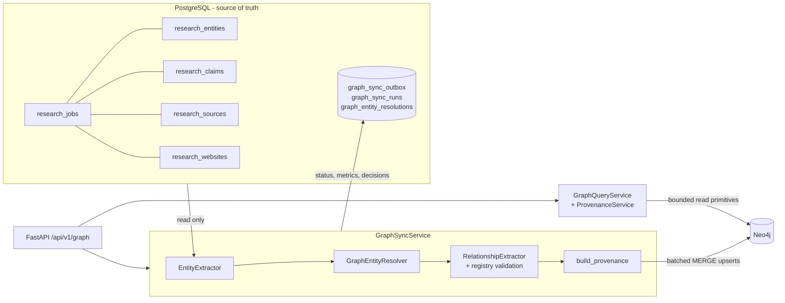

# Knowledge graph architecture (Module 5)

Neo4j holds a **derived, evidence-backed projection** of validated research. PostgreSQL stays the
source of truth: nothing is deleted or moved out of it, and a graph outage never touches research
records. Code: `backend/app/graph/`.

| Component | File | Role |
| --- | --- | --- |
| Client | `neo4j_client.py`, `graph_config.py` | Official async driver 5.28, lazy creation, managed read/write transactions, per-query timeout, pool size, error mapping |
| Health | `graph_health.py` | `connected` only after a verified round trip; else `disconnected` / `unavailable` / `not_configured` |
| Schema | `graph_schema.py` | Label and relationship allowlists, relationship registry, constraints, indexes, schema version |
| Extraction | `entity_extractor.py`, `normalization.py` | Stored Module 3 records to typed graph entities, Source and Claim nodes |
| Resolution | `entity_resolver.py` | Cross-job deduplication in six stages; uncertain matches go to review |
| Relationships | `relationship_extractor.py` | Claim predicate to validated relationship; inference rules marked `inferred` |
| Provenance | `provenance_manager.py` | Source -SUPPORTS-> Claim -MENTIONS-> entity; traversal helpers |
| Persistence | `graph_repository.py` | One interface; `Neo4jGraphRepository` (Cypher) and `InMemoryGraphRepository` (tests and parity) |
| Sync | `graph_sync_service.py`, `database/repositories/graph_sync_repository.py` | Outbox, batching, retries, reconciliation, dry run |
| Queries | `graph_query_service.py` | 15 required queries and deterministic analytics over repository primitives |

Design rules: labels and relationship types in Cypher come only from the `Label` / `Rel` enums;
all values are parameters; reads run in read transactions; traversal depth and result counts are
capped by settings; no endpoint accepts Cypher. GraphRAG, embeddings and vector indexes are out of
scope (Module 6). The `EvidenceRetriever` and repository interfaces are the extension points.

See `knowledge-graph-schema.md`, `entity-resolution.md`, `relationship-extraction.md`,
`graph-provenance.md`, `graph-synchronization.md`, `graph-query-guide.md`, `neo4j-setup.md`.
