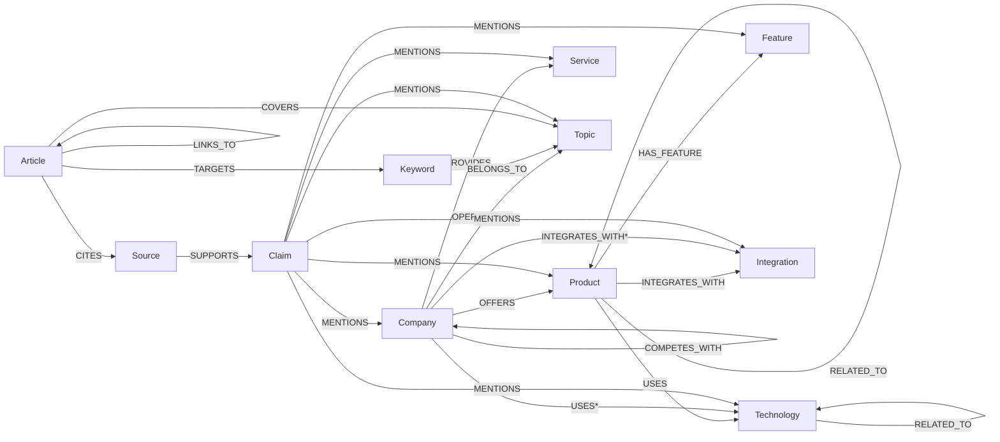

# Knowledge graph schema (version 5.1.0)

Source of truth: `backend/app/graph/graph_schema.py`. Every node has its type label **and**
`GraphNode` (unique `id`), plus `created_at` / `updated_at` (ISO-8601 UTC strings).

`*` documented extensions: Module 3 attaches technology mentions and integrations to companies as
well as products, so `Company` is an allowed source for `USES` and `INTEGRATES_WITH`. `MENTIONS`
also allows `Integration` and `Topic` targets.

## Nodes and identifiers

| Label | Key properties | `id` |
| --- | --- | --- |
| Company | canonical_name, normalized_name, official_domain, website_url, description, industry, headquarters, founded_year, verification_status, source_record_id | `uuid5(aurora:graph:company:<domain>)` when the domain is a **verified official** website; otherwise the Module 3 `entity_key` |
| Product / Service / Feature | canonical_name, normalized_name, description, category, product_url/service_url, company_id, verification_status, source_record_id | Module 3 `entity_id_for(type, website, match_key)` (identical for claim-object entities) |
| Technology | canonical_name, normalized_name, category, description, official_documentation_url, verification_status | Module 3 global id (`scope "*"`) |
| Integration / Topic | canonical_name, normalized_name, description, ... | `uuid5(aurora:graph:<kind>:<match_key>)` (shared concepts) |
| Keyword / Article | keyword, normalized_keyword, search_intent, language / title, canonical_url, article_type, publication_date, content_hash | schema ready; producers arrive in Modules 6-7 |
| Source | url, normalized_url, domain, title, source_type, credibility_metadata (JSON text), content_hash, retrieved_at | `uuid5(aurora:graph:source:<normalized url>)`: one node per URL, all `research_sources.id` in `source_record_ids` |
| Claim | subject, predicate, object_value, claim_text, evidence_excerpt (<=1000 chars), verification_status, confidence, extraction_method, observed_at, research_job_id, evidence_id | `research_claims.id`; `evidence_id` = `c-<10 hex>` as cited in Module 4 reports |

Common entity properties: `match_key` (identity form), `scope_domain`, `aliases`,
`original_names`, `source_record_ids`, `source_urls`, `research_job_ids`, `confidence`,
`derived_from_claim`, `conflicting_properties`. Full article text is never stored.

## Relationship properties

Fact relationships (OFFERS, PROVIDES, USES, HAS_FEATURE, INTEGRATES_WITH, OPERATES_IN,
COMPETES_WITH, RELATED_TO): `claim_ids`, `evidence_ids`, `source_ids`, `source_record_ids`,
`research_job_ids` (all unioned across syncs), `verification_status` (strongest seen),
`assertion` (`direct` / `inferred`), `has_conflict`, `confidence` (max), `extraction_method`,
`basis` (why it was inferred), `first_observed_at`, `last_observed_at`. SUPPORTS carries
`excerpt_verified`; MENTIONS carries `role` (`subject` / `object`) and is merged per role.
Symmetric types (COMPETES_WITH, RELATED_TO) are stored once with `source_id < target_id`.

## Registry

`REGISTRY[Rel]` defines allowed source and target labels, whether evidence is mandatory, whether
the type can be inferred, symmetry, and required properties. `check_relationship()` rejects unknown
names, wrong direction, wrong endpoint types and cross-type COMPETES_WITH / RELATED_TO.

## Constraints and indexes (idempotent, `IF NOT EXISTS`)

- Uniqueness: `GraphNode.id`, `<Label>.id` for all 11 labels, `GraphSchemaVersion.id`.
- Range indexes: `canonical_name` and `normalized_name` (Company, Product, Service, Technology,
  Feature, Integration, Topic); `Company.official_domain`, `Company/Product.verification_status`;
  `Source.url / normalized_url / domain`; `Article.canonical_url`; `Keyword.normalized_keyword`;
  `Claim.verification_status / research_job_id / predicate`.
- Version: `(:GraphSchemaVersion {id: 'aurora'}).version = "5.1.0"`.

Neo4j 5 Community supports everything used here. Node-key and property-existence constraints
(Enterprise) are deliberately not used, and APOC is not required. `find_nodes` name search uses
`CONTAINS`, which range indexes do not accelerate; add a text index if lookups grow. Nothing drops
constraints or indexes automatically.
