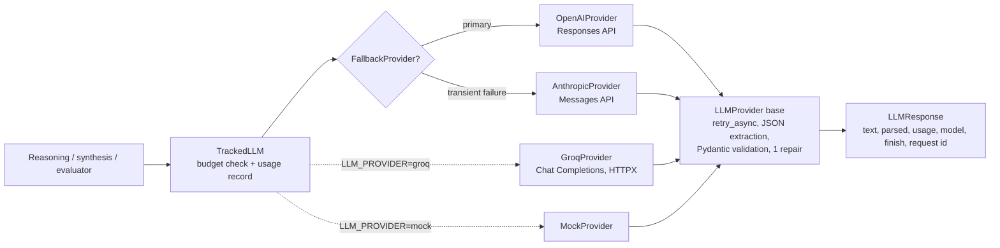

# LLM provider architecture (Module 4)

Code: `backend/app/llm/`. Business services never touch an SDK object; they call
`TrackedLLM` (budget check + usage record) around an `LLMProvider`.



## Contract (`base.py`, `models.py`)
- `generate(prompt, system=...)` → `LLMResponse`; `generate_structured(prompt, Schema)`
  → `(Schema instance, LLMResponse)`. `stream()` is reserved and raises `NotImplementedError`.
- `LLMResponse` carries text, parsed output, provider, model, input/output/cached/total
  tokens (`None` when the provider did not report them), duration, finish status
  (`completed|truncated|filtered|other`), provider request id, estimated cost and metadata.
- Retries reuse `tools/http.retry_async`: exponential backoff with full jitter, at most
  `LLM_MAX_RETRIES`, never shorter than a `Retry-After` hint (capped at 30 s). Only
  retryable errors (rate limit, timeout, connection, 5xx) are retried; authentication and
  invalid-request errors are not.
- Errors are normalized by `classify_sdk_error` (class name + HTTP status) into the shared
  `ProviderError` taxonomy. SDK messages are discarded so keys or prompts never leak.
- Structured output: invalid JSON, schema failures or truncation raise `LLMOutputError`
  after **one** repair request (usage of both calls is summed). Unvalidated data is never
  returned.
- SDK retries are disabled (`max_retries=0`), so the shared policy is the only one.
  Clients are created lazily on the first request, never at import or startup.

## OpenAI (`openai_provider.py`)
`client.responses.create(model, input, instructions, max_output_tokens, store=False,
timeout, text={"format": {"type": "json_schema", "name", "schema", "strict": False}})`.
Strict mode is off because Pydantic schemas use optional/default fields; Pydantic
validates the result instead. Usage comes from `usage.input_tokens`, `usage.output_tokens`
and `usage.input_tokens_details.cached_tokens`; `status="incomplete"` maps to
`truncated`/`filtered`. **The `openai` package is not installed in the dev environment**,
so this adapter is verified only with an injected fake client. Install it and run the
live test before relying on it. The retired Assistants API is not used.

## Anthropic (`anthropic_provider.py`)
`client.messages.create(model, max_tokens, system, messages, timeout)`. Structured output
uses one forced tool (`tool_choice={"type": "tool", "name": "record_result"}`) whose
`input_schema` is the Pydantic JSON schema; the tool input is validated like any other
output. Usage: `input_tokens`, `output_tokens`, `cache_read_input_tokens`. Parameter
names were checked against the installed `anthropic` 0.125.0.

## Groq (`groq_provider.py`)
Groq's OpenAI-compatible **Chat Completions** endpoint, `POST {GROQ_BASE_URL}/chat/completions`
(default `https://api.groq.com/openai/v1`), called with HTTPX. Chat Completions is Groq's
stable API. Its Responses API is in beta, so the existing OpenAI Responses adapter is **not**
reused. No SDK dependency is added. The base URL must be HTTPS (plain HTTP only for
`localhost`/`127.0.0.1` test servers).

- **Structured output:** `response_format` of type `json_schema` with `strict: false`
  (default, `GROQ_STRUCTURED_OUTPUT=json_schema`), or `json_object` (JSON mode, schema
  described in the prompt). Groq's docs list `openai/gpt-oss-20b` and `openai/gpt-oss-120b`
  as supporting JSON schema, in strict and best-effort modes. Strict mode requires every
  property to be required and `additionalProperties: false`, which AURORA's optional and
  default fields do not satisfy, so best-effort is used. Pydantic validates every reply
  regardless. Streaming and tool use cannot be combined with structured outputs; AURORA
  uses neither.
- **Schema rejection:** Groq can refuse a generation that misses the schema with HTTP 400
  (`json_validate_failed`, "does not match the expected schema"). This is raised as
  `LLMOutputError`, so the shared single repair attempt runs. The rejected request returns
  no usage, so its tokens are not counted (see the cost document).
- **Reasoning:** `include_reasoning: false` by default (`GROQ_EXCLUDE_REASONING=true`), so
  reasoning text is not returned. If a model sends `message.reasoning` anyway, it is
  ignored. `reasoning_effort` (`low|medium|high`) is optional. `reasoning_format` is not
  used because Groq documents it as unsupported for gpt-oss.
- **Usage:** `usage.prompt_tokens`, `usage.completion_tokens` and
  `usage.prompt_tokens_details.cached_tokens`. Missing values stay `null`.
- **Errors:** 429 → rate limit (honours `retry-after`); 5xx/408/425 → unavailable; 401/402/403 →
  authentication; other 4xx → request error; timeouts and connection failures are normalized.
  Only retryable errors are retried. Error bodies and keys are never propagated.
- **Key handling:** the key is sent only as the `Authorization` header and is never logged. The
  app starts and runs with `LLM_PROVIDER=groq` without any OpenAI or Anthropic key.

## Selection and fallback (`provider_factory.py`)
- `LLM_PROVIDER=openai|anthropic|mock` (default `mock`, so the app starts without keys).
- A request's `preferred_provider` / `preferred_model` is honoured only through
  `build_llm_provider(..., allow_override=True)`. The provider must be configured, and a
  custom model must be the configured one or have an entry in `LLM_PRICING_JSON`.
- `LLM_ENABLE_PROVIDER_FALLBACK=true` wraps the primary in `FallbackProvider` when
  `LLM_FALLBACK_PROVIDER` is configured and different. Fallback happens only for
  `provider_rate_limited|provider_unavailable|provider_timeout` *after* the primary's own
  retries. Authentication, invalid requests and malformed output do not fall back.
  The answering provider/model and `fallback_from`/`fallback_reason` are recorded. Both
  providers share the same tracker, so budgets apply to the pair. If both fail, the error
  propagates and the analysis is marked partial or failed. Nothing is fabricated.

## Mock (`mock_provider.py`)
Deterministic replies, either per schema name or a minimal schema-valid instance. A
`script` can simulate rate limits, authentication failures, timeouts and malformed output,
and token usage is controllable. All normal tests use it. Reports produced with it are
always flagged and never `completed`.

## Live verification
Not performed. `backend/tests/test_llm_live.py` makes one tiny structured request per
configured provider when `AURORA_RUN_LIVE_LLM_TESTS=true`.

## Groq-only local configuration (recommended low-cost setup)
1. Create a key: sign in at `console.groq.com`, open **API Keys**, click **Create API Key**,
   name it (for example `aurora-local`) and copy it once; it is not shown again. The key's
   rate limits follow your account plan (Free or Developer).
2. Put only these lines in the root `.env` (never in docs, logs or git):
   ```
   LLM_PROVIDER=groq
   GROQ_API_KEY=<your key>
   GROQ_MODEL=openai/gpt-oss-20b
   GROQ_BASE_URL=https://api.groq.com/openai/v1
   LLM_PRICING_JSON={"groq:openai/gpt-oss-20b": {"input_per_million": 0.075, "output_per_million": 0.30, "cached_input_per_million": 0.037, "currency": "USD"}}
   ```
   No OpenAI or Anthropic key is needed; those adapters stay available for later.
3. Start the API as usual. `GET /api/v1/intelligence/{job_id}` shows `provider: "groq"`,
   the model and the effective evidence budget (`progress.context_token_budget`, 4 000 by
   default for Groq; see `llm-cost-management.md` to change it).
4. First check with one tiny request:
   `AURORA_RUN_LIVE_LLM_TESTS=true python -m pytest backend/tests/test_llm_live.py -k groq -v`.

**Status:** every Groq code path is verified with mocked HTTP only. No live Groq request
has been made from this repository, and Free-plan limits were not confirmed from an
official source.
