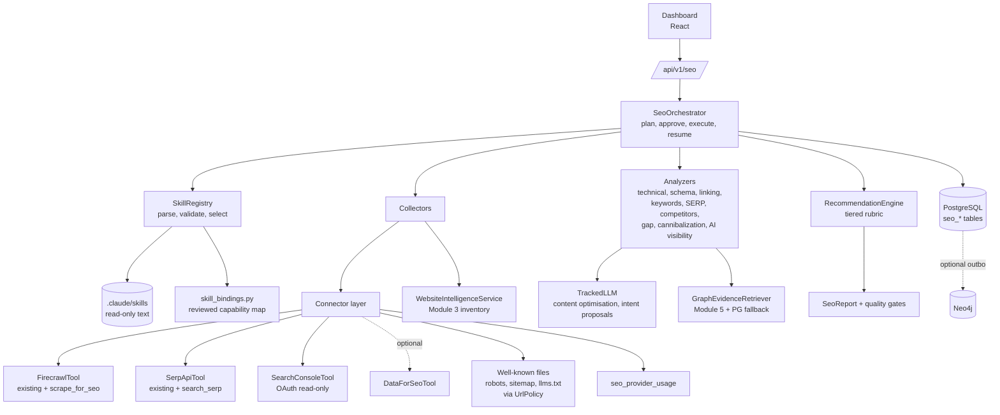
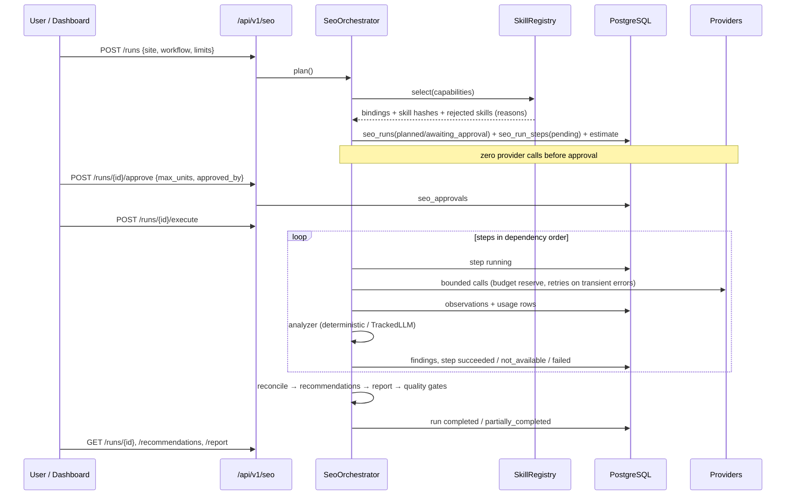

# Module 6 design — Skill-driven SEO intelligence engine

**Status:** proposal for review (2026-10-31). Nothing in this document is implemented. Decisions
that need approval are collected in §11.

Module 6 turns AURORA's research, website intelligence, synthesis and graph layers into an SEO
analysis platform. The installed skills in `.claude/skills/` supply *method*: what to check, in
which order, what evidence each conclusion needs, and how to prioritise. The backend supplies
*execution*: data collection, deterministic analysis, validation, persistence, cost control and
APIs. Skill text is never executed and never grants a capability.

---

## 1. Existing architecture assessment

### 1.1 What Module 6 can reuse as-is

| Capability | Where | Reuse in Module 6 |
| --- | --- | --- |
| URL/SSRF policy, redirect revalidation | `research/url_policy.py` (`UrlPolicy.validate`, `trace_redirects` HEAD-hop tracing) | Every fetch target; the redirect chain for technical checks |
| Source building and provenance | `research/source_manager.py` | Every fetched page becomes a `ResearchSource`-style record with hash and timestamps |
| robots.txt fetch and parse | `research/robots.py` (no redirects, 512 KB cap, `RobotFileParser`) | Crawlability checks for Googlebot and AI crawlers (same parser, different user agents) |
| Site discovery, mapping, bounded crawl, processed documents with sections/canonical | `research/website_intelligence_service.py`, `website_mapper`, `intelligent_crawler`, `content_processor` | URL inventory (`mapped_pages`), heading sections, page types; a target site audit can start from an existing Module 3 job |
| Evidence claims with verbatim excerpts | `research_claims` + `evidence_manager` | Business facts about the audited company and competitors |
| SerpApi adapter | `tools/serpapi_tool.py` (retries, concurrency gate, metrics) | SERP observations (needs an additive parser, see 1.2) |
| Firecrawl adapter | `tools/firecrawl_tool.py` (`scrape_url`, `map_site`, `batch_scrape`, 8 MB cap) | Page fetches (needs an additive format option, see 1.2) |
| HTTP retry/circuit-breaker helpers | `tools/http.py` (`retry_async`, `send_bounded`, `build_timeout`) | New GSC / DataForSEO adapters |
| Provider request budget per run | `core/metrics.py` (`start_run`, `reserve_request`) | Per-run unit budgets for SERP/scrape/GSC calls |
| LLM layer | `llm/` (`TrackedLLM`, `UsageTracker`, `PricingRegistry`, budgets, Groq/mock/fallback) | All LLM-assisted analysis; costs only from `LLM_PRICING_JSON` |
| Evidence-id validation, versioned prompts, quality gates | `intelligence/` (context builder, reasoning validation, `quality_evaluator`) | Same pattern for SEO prompts and SEO reports |
| Graph queries and provenance | `graph/graph_query_service.py`, `provenance_manager.py`, in-memory + Neo4j repositories | GraphRAG evidence (§3.2, 6.5); `Keyword`, `Article`, `TARGETS`, `COVERS`, `LINKS_TO` already exist in the schema with no producer |
| Outbox sync | `graph/graph_sync_service.py` + `graph_sync_outbox` | Optional later projection of SEO pages/keywords into Neo4j |

### 1.2 Gaps found in existing code (additive changes needed)

1. **Firecrawl returns Markdown only** (`formats: ["markdown"]`, `onlyMainContent: true`). Technical
   SEO needs `<head>` tags (title, meta robots, canonical, hreflang, viewport), all headings, all
   links with anchors and placement, and JSON-LD. **Proposal:** add a new method
   `FirecrawlTool.scrape_for_seo(url)` requesting `["markdown", "rawHtml", "links"]`. Existing
   methods are not changed. Raw HTML is parsed then discarded (only signals + hash are stored).
2. **SerpApi keeps organic results only** (`_parse` reads `organic_results`). SERP analysis needs
   people-also-ask, related searches, featured snippet, AI Overview presence/citations, local pack,
   shopping, ads presence, and the search location/device. **Proposal:** add
   `SerpApiTool.search_serp(query, locale, device)` returning a `SerpSnapshot` parsed from the same
   single request. Existing `search` is not changed.
3. **Response headers are not captured.** `X-Robots-Tag`, `Link: rel=canonical` and the final
   status need the HEAD responses that `UrlPolicy.trace_redirects` already makes. **Proposal:**
   record an allow-listed set of headers on `RedirectTrace` (additive field).
4. **`llm_usage_records.analysis_id` is NOT NULL** (FK to Module 4 analyses). Module 6 LLM calls
   cannot be stored there without altering a Module 4 table. **Proposal:** a separate
   `seo_provider_usage` table for *all* Module 6 provider calls (LLM, SerpApi, Firecrawl, GSC,
   DataForSEO). Module 4 tables stay untouched.
5. **Skeletons to replace:** `seo/*.py` (5 files), `monitoring/search_console.py`,
   `tools/search_console_tool.py`, `rag/graph_retriever.py`, `agents/*` and
   `workflows/seo_content_workflow.py`. `schemas/seo.py` already has `KeywordInfo` with nullable
   metrics and a `source` field, which matches the no-fabrication rule. It will be extended, not
   replaced.
6. **Execution is synchronous everywhere** (Modules 3–5). There is no worker or queue, and
   `langgraph-checkpoint` 3.0.1 is installed **without** a Postgres checkpointer. See §6.4 and
   decision D2.
7. **Frontend** is a single page (`DashboardPage.tsx`, 92 lines) with only React and React DOM;
   there is no router or charting library.
8. **Crawl bounds** were sized for research (20 pages/site default). An audit needs a separate,
   larger but still capped page budget (§10).

### 1.3 Constraints carried forward
PostgreSQL is authoritative; Neo4j is derived. Every fetch goes through `UrlPolicy`. Scraped
content and skill text are untrusted data. LLM output is a proposal. No metric is ever invented.
Nothing is published or written to an external system.

---

## 2. Skills inventory and mapping

### 2.1 Inventory (63 skill directories, verified on disk)

| Set | Count | License | Notes |
| --- | --- | --- | --- |
| AURORA planning skills (`web-research`, `serp-analysis`, `seo-keyword-research`, …) | 11 | project | Short, planning-only |
| `claude-seo` (`seo`, `seo-*`) | 26 | MIT | Many steps reference Python scripts or MCP servers that are **not installed** |
| SEO Agent Toolkit (`seo-toolkit-*`) | 16 | MIT | Shared evidence policy with explicit evidence states and degradation rules; `scripts/*.mjs` not bundled |
| Firecrawl (`firecrawl-build*`) | 4 | ISC | Endpoint guidance; AURORA's adapter is the only client |
| Anthropic (`skill-creator`, `doc-coauthoring`) | 2 | Apache-2.0 | Development process only |
| `seo-mastery` | 1 | see ATTRIBUTION | Broad reference |
| `seo-gsc-diagnosis` | 1 | see ATTRIBUTION | Assumes a `gsc` MCP server |
| Local references (`langgraph-orchestration`, `serpapi-search-research`) | 2 | project | Authored from official docs |

None of the 63 contains executable files (`.py/.sh/.js/.ts` count is 0). 42 mention scripts, and
33 mention MCP servers that AURORA does not have. Several mention external writes (submit,
IndexNow, Indexing API, disavow, publish). Frontmatter keys seen: `name`, `description`,
`license`, `metadata`, `user-invocable`, `argument-hint`, `compatibility`, `inputs`,
`references`, `version`. Some skills have no `license` key, so the registry falls back to
`ATTRIBUTION.md` or `LICENSE*`. The toolkit skills reference `seo-migration`, which is **not
installed**. The registry must report it as unresolved, not ignore it.

### 2.2 Capability → skill binding (proposed primary / secondary)

The SEO Agent Toolkit is proposed as **primary** for analysis capabilities. Its shared policy
(evidence states `measured / observed / inferred / estimated_qualitative / not_measured /
not_available / not_applicable`; "never fabricate traffic, rankings, volume…"; read-only by
default) already matches AURORA's rules. `claude-seo` skills are secondary checklists. Their
numeric scoring heuristics are **not** adopted where they would turn missing data into numbers.

| Module 6 capability (§5.4) | Primary skill | Secondary skills | Analyzer type | Data required |
| --- | --- | --- | --- | --- |
| Technical SEO | `seo-toolkit-technical-audit` | `seo-technical`, `seo-sitemap`, `seo-hreflang`, `seo-images`, `seo-mastery` | Deterministic | Page signals, robots.txt, sitemap, redirects, headers |
| Single-page audit | `seo-toolkit-page-audit` | `seo-page` | Deterministic + optional LLM | One page snapshot |
| Keyword research | `seo-toolkit-keyword-research` | `seo-keyword-research`, `seo-cluster`, `seo-dataforseo` | Deterministic (+ LLM intent proposal) | Seeds, SERP features, optional GSC/DataForSEO metrics |
| SERP analysis | `seo-toolkit-serp-analysis` | `serp-analysis`, `serpapi-search-research`, `seo-sxo` | Deterministic | SERP snapshots |
| Competitor analysis | `seo-toolkit-strategy` | `seo-competitor-pages` (analysis parts only), `seo-plan` | Deterministic + graph | SERP overlap + Module 5 graph |
| Content gap | `seo-toolkit-content-brief` | `seo-content-brief`, `seo-content-strategy`, `seo-cluster` | Deterministic coverage + optional LLM grouping | Own + competitor page sections, entities |
| Content optimization | `seo-toolkit-content-optimizer` | `seo-content`, `seo-quality-audit`, `seo-geo` | LLM-assisted (proposals) | Page sections, SERP context, evidence |
| Schema validation | `seo-toolkit-schema` | `seo-schema` | Deterministic | JSON-LD / microdata blocks |
| Internal linking | `seo-toolkit-internal-linking` | `seo-cluster` (hub/spoke) | Deterministic graph analysis | Crawled link graph |
| Cannibalization | `seo-toolkit-cannibalization` | — | Deterministic | GSC query×page rows (measured) or SERP co-occurrence (observed) |
| AI search visibility | `seo-toolkit-ai-visibility` | `seo-geo`, `seo-agentic`, `seo-mastery` | Deterministic access checks + LLM citability (proposal) | robots.txt AI agents, llms.txt, SERP AI Overview data, user-supplied observations |
| Indexation (GSC) | `seo-toolkit-indexation-analysis` | `seo-google`, `seo-gsc-diagnosis` | Deterministic | URL Inspection + sitemap + crawl |
| Performance (GSC) | `seo-toolkit-performance-analysis` | `seo-google` | Deterministic | Search Analytics rows |
| Change tracking | — | `seo-drift` | Deterministic diff | Two run snapshots |
| Prioritization | `seo-toolkit-prioritization` | `seo-flow` | Deterministic rubric | Findings |
| Orchestration / synthesis | `seo-toolkit-orchestrator` | `seo`, `seo-audit`, `seo-flow` | Planner rules (not LLM routing) | Workflow request |

### 2.3 Skills deliberately not bound in Module 6

| Skill(s) | Reason |
| --- | --- |
| `seo-image-gen` | Generates assets via an external MCP; content creation, not analysis |
| `seo-blog-writer`, `seo-competitor-pages` (page generation), `wordpress-publishing` | Content creation and publication belong to Modules 7–8 |
| `seo-backlinks`, `seo-maps`, `seo-local` (GBP), `seo-ecommerce` (Shopping/marketplace) | Need data sources AURORA does not have (backlink index, GBP/maps APIs, merchant data). Listed as `reference_only`; can be bound later behind DataForSEO |
| `seo-programmatic`, `seo-toolkit-programmatic` | Only relevant to sites with templated page sets; bindable later as a technical sub-check |
| `firecrawl-build*`, `langgraph-orchestration`, `knowledge-graph`, `graphrag-research`, `skill-creator`, `doc-coauthoring`, `web-research`, `fact-verification`, `firecrawl-extraction` | Development guidance for building Module 6 itself, not runtime method |

### 2.4 How a skill is "used" at runtime (the execution model)

A skill contributes in exactly three ways:

1. **Design-time method.** Analyzer rules, check lists, thresholds and degradation behaviour are
   implemented in Python *from* the bound skill. Each rule records its origin
   (`skill_ref = {skill, section, content_hash}`) so a finding can say which method produced it.
2. **Planning metadata.** The registry's parsed metadata (description, "Use when / Do NOT use"
   clauses, inputs) drives deterministic selection and shows *why* a skill was or was not used.
3. **Bounded guidance excerpts for LLM steps.** An LLM-assisted analyzer may include specific,
   pre-reviewed sections (for example the content-optimizer checklist) as a delimited "reference
   method" block. The block is capped in tokens and placed beneath AURORA's system rules. It is
   pinned by content hash, so if the file changes on disk the excerpt is withheld until
   re-reviewed. The deterministic analyzer still runs.

A skill can never add a tool, a URL, a provider call, a database write or a publication step.
Those exist only in code.

---

## 3. Module 6 architecture



### 3.1 Package layout (proposed)

```
backend/app/seo/
  skills/        registry.py (discovery, frontmatter, validation, hashing)
                 bindings.py (reviewed capability → skill map, guidance excerpts)
                 safety.py (unsafe-instruction scanner)  selection.py
  orchestrator/  planner.py  executor.py  approvals.py  budget.py  state.py
  connectors/    base.py (capability protocols)  serp.py  pages.py  search_console.py
                 dataforseo.py  wellknown.py  usage.py (unit + cost recording)
  parsing/       html_signals.py (bs4 html.parser)  structured_data.py  sitemap.py
  analyzers/     technical.py  page.py  schema.py  internal_links.py  keywords.py
                 serp.py  competitors.py  content_gap.py  content_optimizer.py
                 cannibalization.py  ai_visibility.py  performance.py  drift.py
  recommendations/ catalog.py (action types: effort/risk/reversibility defaults)
                   engine.py (rubric, tiers, ordering)
  reporting/     report.py  quality.py
  prompts/       versioned prompt modules (same convention as intelligence/prompts)
  service.py     SeoService facade used by routes
backend/app/rag/graph_retriever.py   GraphEvidenceRetriever (replaces skeleton)
backend/app/database/repositories/seo_repository.py
backend/app/api/routes/seo.py, backend/app/schemas/seo.py (extended)
```

The existing `seo/*.py` skeleton classes (`SeoAuditor`, `KeywordResearchService`, …) become thin
facades over the analyzers so their names keep meaning. `agents/` stays a skeleton. Module 6 does
deterministic work in services, as `agents/base.py` prescribes. Agents are introduced only if an
LLM step needs a role.

### 3.2 Component responsibilities

**6.1 Skill registry**
- **Discover:** `SEO_SKILLS_DIR/*/SKILL.md`, flat layout only. Symlinks are refused, and resolved
  paths must stay inside the skills root.
- **Parse:** YAML frontmatter via `yaml.safe_load` with a size cap. Body headings are indexed.
  Reference links (`references/*.md`) are validated against path traversal.
- **Categorize:** by binding (capability) when bound; otherwise by name prefix and a keyword
  classifier. Status is `bound`, `reference_only`, `excluded` or `invalid`.
- **Resolve dependencies:**
  - Markdown links to reference files.
  - Sibling-skill mentions, mapped through an alias table built from `ATTRIBUTION.md` (upstream
    `seo-page-audit` → installed `seo-toolkit-page-audit`).
  - Shared-policy includes.
  - Anything unresolved (for example `seo-migration`) is reported.
- **Safety scan:** flags script execution (`npx`, `node scripts`, `pip install`, `curl … | sh`),
  credential handling (`.env`, API keys), external writes (submit, IndexNow, Indexing API, disavow,
  publish, deploy), MCP dependencies and injection phrasing. Flags are **informational**: no skill
  can execute anything anyway, but a flagged section is never used as an LLM guidance excerpt.
- **Conflicts:** two skills bound to the same capability resolve by binding priority. Conflicting
  guidance resolves by precedence: `CLAUDE.md` rules > AURORA binding rules > toolkit shared
  policy > other skill text. Each resolved conflict is listed in the registry report.
- **Select:** a workflow type maps to capabilities, then to bindings, deterministically. For a
  free-text objective, a lexical match against descriptions and "Use when / Do NOT use" clauses
  *suggests* capabilities. An optional LLM classifier may propose capabilities from a closed
  enum; it is validated, can never add tools, and is off by default.
- **Version:** each run stores the manifest hash plus every used skill's content hash, so reports
  are reproducible.

**6.2 SEO orchestrator:** see §6.

**6.3 Connectors:** capability protocols rather than vendor classes:

| Protocol | Implementations | Evidence state of output |
| --- | --- | --- |
| `SerpProvider.observe(query, locale, device)` | SerpApi (wraps existing tool); DataForSEO SERP (optional) | `observed` at timestamp + location |
| `PageProvider.fetch(url)` | Firecrawl `scrape_for_seo` (existing adapter) | `observed` |
| `WellKnownFetcher` | robots.txt, sitemap(s), llms.txt via `UrlPolicy`, no redirects, size caps | `observed` |
| `KeywordMetricsProvider` | DataForSEO (optional) | `measured` (provider, period) |
| `SearchPerformanceProvider` | Google Search Console Search Analytics | `measured` (own property) |
| `IndexInspectionProvider` | GSC URL Inspection API | `measured` |
| `FieldDataProvider` (optional, decision D6) | PageSpeed Insights / CrUX | `measured` (field) / `observed` (lab) |

- **Adapters:** every adapter extends `ExternalTool`, uses `tools/http.py` retries, reports
  missing credentials by name, and is constructed by injection, never at import.
- **Usage:** every call writes a `seo_provider_usage` row with units (searches, credits, rows,
  tokens). Money cost is filled only from configured pricing (`SEO_PROVIDER_PRICING_JSON`) or a
  provider-reported cost such as DataForSEO's `cost` field. Otherwise it is `null` with
  `cost_available=false`.
- **Google Search Console (design):**
  - **Access:** OAuth 2.0 refresh token using the existing `GOOGLE_CLIENT_ID/SECRET/REFRESH_TOKEN`
    settings and scope `webmasters.readonly` only. The access token stays in memory and is never
    logged.
  - **Property check:** `sites.list` confirms the user's permission on the property before any
    query.
  - **Search Analytics:** `searchanalytics.query`, paged within the 25k-row limit, dimensions
    date/query/page/country/device. It is labelled with GSC's data freshness, and anonymised
    queries are reported as such.
  - **URL Inspection:** called within per-property daily quotas, which are configurable rather
    than hardcoded.
  - **Writes:** none. No sitemap submission and no Indexing API; those would be external writes.
  - **HTTP:** HTTPX direct, with no Google SDK dependency.
- **DataForSEO (design, off by default):**
  - Basic auth through `DATAFORSEO_LOGIN/PASSWORD`, using live endpoints for keyword search
    volume, keyword ideas and SERP.
  - The per-task cost from the response is recorded.
  - It is enabled per run only after approval. The backlinks API needs a separate subscription and
    stays out of scope.

**6.4 Analyzers:** §5.4 below lists the checks. Each analyzer is a pure function from typed
inputs to `Finding` objects. It has `analyzer_version`, `skill_refs` and an explicit
`not_available` result when its required data is missing. It never produces a guessed value.

**6.5 GraphRAG integration:** `GraphEvidenceRetriever` sits over `GraphQueryService` and
`ProvenanceService`:
- **Input:** the audited company resolved by `company_id_for_domain(domain)`, plus
  competitor/product ids.
- **Output:** an `EvidenceBundle` split into `facts` and `hypotheses`.
  - `facts` contains `assertion=direct` edges with a verified status. Each carries claim ids,
    source URLs and verbatim excerpts.
  - `hypotheses` contains every `inferred` edge (industry-based `COMPETES_WITH`, mention-based
    `USES`) with its `basis`. These are never shown as facts.
- **Fallback:** if Neo4j is not configured or is unavailable, a `PostgresEvidenceRetriever` with
  the same interface reads `research_claims` and `research_entities` directly. That is possible
  because the graph is derived from them. The bundle records which backend served it.
- **Uses:** the business competitor set (versus SERP competitors), entity coverage for content
  gaps, and grounding for content suggestions.
- **Scope:** vector retrieval (ChromaDB) is not used in Module 6 (decision D1).

**6.6 Recommendation engine:** see §5.5.

**6.7 API and dashboard:** see §7 and §5.6.

---

## 4. Database design (PostgreSQL, additive only)

Two additive migrations. No Module 1–5 table is altered.

### 4.1 Migration `0005_seo_core`: runs, approvals, findings, recommendations, usage

| Table | Purpose | Key columns / constraints |
| --- | --- | --- |
| `seo_sites` | Audited target sites | `id`, `domain` UNIQUE (normalized), `display_name`, `gsc_property` NULL, `default_country`, `default_language`, `research_job_id` NULL FK `research_jobs` ON DELETE SET NULL, `created_at` |
| `seo_runs` | One workflow execution | `id`, `site_id` FK CASCADE, `workflow_type`, `objective`, `status` (`planned`, `awaiting_approval`, `approved`, `running`, `partially_completed`, `completed`, `failed`, `cancelled`), `plan` JSONB (steps, selected/rejected skills with reasons, manifest + skill hashes), `limits` JSONB, `estimate` JSONB (units per provider), `usage_summary` JSONB, `error_summary`, timestamps; index (`site_id`, `created_at`) |
| `seo_run_steps` | Step ledger (the durable workflow state) | `id`, `run_id` FK CASCADE, `step_key`, `capability`, `analyzer`, `skill_refs` JSONB, `depends_on` JSONB, `status` (`pending`, `skipped`, `running`, `succeeded`, `failed`, `not_available`), `attempts`, `input_refs` JSONB, `output_summary` JSONB, `error_category`, timestamps; UNIQUE (`run_id`, `step_key`) |
| `seo_approvals` | Human approval audit | `id`, `run_id` FK CASCADE, `step_key` NULL, `kind` (`provider_spend`, `paid_provider`, `llm_budget`, `gsc_access`), `requested` JSONB (estimate), `decision` (`approved`, `rejected`), `decided_by`, `decided_at`, `note` |
| `seo_findings` | Analyzer output | `id`, `run_id`, `step_id`, `site_id`, `fingerprint` (sha256 of site+check_id+normalized scope), `category`, `check_id`, `severity`, `title`, `detail`, `affected_urls` JSONB, `evidence` JSONB (typed refs: page snapshot / SERP result / GSC row / claim / graph edge, each with evidence state), `evidence_state` (weakest), `origin` (`deterministic` or `llm`), `analyzer_version`, `skill_refs` JSONB; index (`site_id`, `fingerprint`), (`run_id`, `category`) |
| `seo_recommendations` | Ranked actions | `id`, `run_id`, `site_id`, `fingerprint`, `finding_ids` JSONB, `action_type`, `title`, `rationale`, `basis` (`measured`, `observed`, `inferred`, `hypothesis`), `impact`, `confidence`, `effort`, `risk`, `reversibility` (ordinal labels incl. `not_available`), `tier`, `rank`, `dependencies` JSONB, `validation_check`, `lifecycle_status` (`open`, `accepted`, `rejected`, `deferred`, `in_progress`, `implemented`, `verified`, `regressed`), `owner`, timestamps; index (`site_id`, `lifecycle_status`, `tier`) |
| `seo_recommendation_events` | Progress history | `id`, `recommendation_id` FK CASCADE, `from_status`, `to_status`, `actor`, `note`, `run_id` NULL (when a later run verified/regressed it), `created_at` |
| `seo_provider_usage` | Every external/LLM call | `id`, `run_id` FK CASCADE, `step_key`, `provider`, `operation`, `model` NULL, `units`, `unit_type`, `input_tokens`/`output_tokens` NULL, `estimated_cost` NULL, `cost_available`, `success`, `error_category`, `duration_seconds`, `requested_at`; index (`provider`, `requested_at`) for daily caps |

### 4.2 Migration `0006_seo_observations`: collected data

| Table | Purpose | Key columns / constraints |
| --- | --- | --- |
| `seo_page_snapshots` | One fetched page per run | `id`, `run_id`, `site_id`, `url`, `normalized_url`, `final_url`, `status_code`, `redirect_chain` JSONB, `headers` JSONB (allow-listed), `fetched_via`, `html_hash`, `content_hash`, `signals` JSONB (title, meta description, robots, canonical, hreflang, lang, viewport, OG, headings, word count, image alt stats), `structured_data` JSONB (bounded blocks + parse errors), `source_id` NULL FK `research_sources`, `fetched_at`; UNIQUE (`run_id`, `normalized_url`) |
| `seo_page_links` | Link graph of the crawled sample | `id`, `run_id`, `from_snapshot_id` FK CASCADE, `to_normalized_url`, `anchor_text`, `rel`, `is_internal`, `placement` (`content`, `navigation`, `footer`, `unknown`); index (`run_id`, `to_normalized_url`) |
| `seo_serp_snapshots` | One SERP observation | `id`, `run_id`, `keyword_id` NULL, `provider`, `query`, `country`, `language`, `location`, `device`, `provider_search_id`, `features` JSONB (PAA questions, related searches, featured snippet, AI Overview present + cited URLs, local pack, shopping, ads present), `observed_at` |
| `seo_serp_results` | Results within a snapshot | `id`, `snapshot_id` FK CASCADE, `position`, `result_type`, `url`, `domain`, `title`, `snippet`; index (`domain`) |
| `seo_keywords` | Keyword registry per site | `id`, `site_id`, `keyword`, `normalized`, `language`, `country`, `discovered_via` JSONB (seed/autocomplete/PAA/related/GSC/DataForSEO), `intent` NULL, `intent_basis` (`serp_features`, `llm_proposal`, `user`), `cluster_id` NULL; UNIQUE (`site_id`, `normalized`, `language`, `country`) |
| `seo_keyword_metrics` | Provider metrics, time-stamped | `id`, `keyword_id` FK CASCADE, `run_id`, `provider`, `metric` (`search_volume`, `cpc`, `competition`, `difficulty`, `impressions`, `clicks`, `ctr`, `avg_position`), `value`, `period_start`, `period_end`, `observed_at`. Rows exist only when a provider returned a value. |
| `seo_keyword_clusters` | SERP-overlap clusters | `id`, `site_id`, `run_id`, `label`, `method` (`serp_overlap_k`), `parameters` JSONB, `member_count` |
| `seo_search_performance` | GSC Search Analytics rows | `id`, `site_id`, `run_id`, `date`, `query` NULL (anonymised), `page`, `country`, `device`, `search_type`, `clicks`, `impressions`, `ctr`, `position`, `data_state`; UNIQUE (`site_id`, `date`, `query`, `page`, `country`, `device`, `search_type`) |

Notes:
- Raw HTML is not stored by default; only `html_hash` and extracted signals are.
- History is append-only per run. Progress is computed by comparing fingerprints across runs
  (new, resolved, persisting, regressed).
- Deleting a site cascades to its SEO data only; research jobs are untouched (`SET NULL`).
- Optional Neo4j projection (phase 6.10) uses the existing outbox with new aggregate types:
  - `Article` nodes from page snapshots (observed).
  - `LINKS_TO` from observed internal links.
  - `Keyword` nodes, plus `TARGETS` only for keyword mappings a human **accepted**. Proposals are
    never projected.

---

## 5. Capability design

### 5.1 Collection
- **Site inventory:** reuse the linked Module 3 job's `mapped_pages`, or run
  `WebsiteIntelligenceService.map_website`. Then add sitemap URLs and select up to
  `SEO_AUDIT_MAX_PAGES` (priority: homepage, sitemap, nav-linked, page-type diversity).
- **Scope:** fetches are restricted to the site's registrable domain; subdomains are opt-in.
  Competitor pages are fetched only if they appear in a stored SERP snapshot, and every target
  passes `UrlPolicy`.
- **Coverage:** recorded explicitly (pages audited / URLs known). Every site-level finding is
  qualified "within N audited pages".

### 5.2 Deterministic parsing
- `bs4` with `html.parser` (already a direct requirement; no `lxml`).
- JSON-LD via `json`, size-capped per block; microdata/RDFa are detected and reported but not
  fully parsed.
- Sitemaps through a defused parser:
  - Entity expansion is disabled using stdlib `xml.etree` with a size cap and DOCTYPE rejection.
  - Sitemap indexes are followed to a bounded depth.

### 5.3 Evidence states
These are the toolkit states, used verbatim on every finding, metric and recommendation:
`measured`, `observed`, `inferred`, `estimated_qualitative`, `not_measured`, `not_available`,
`not_applicable`. Synthesis keeps the weakest input's state.

### 5.4 Analyzer checks (summary)

| Analyzer | Checks (examples) | Never claims |
| --- | --- | --- |
| Technical | Status/redirect chains; canonical (missing, non-self, conflicting HTML vs header); meta robots / `X-Robots-Tag` noindex; robots.txt disallow for Googlebot; sitemap validity and mismatches (noindex/non-canonical/redirected URLs in sitemap); duplicate titles/descriptions; H1 count; `lang`/viewport; hreflang codes + reciprocity; mixed content; image alt coverage | Core Web Vitals without PSI/CrUX data (`not_measured`); rendering differences (no raw-vs-rendered comparison) |
| Schema | Parse errors; `@type` recognition; required/recommended properties for a curated type set (Organization, WebSite, BreadcrumbList, Article, Product, SoftwareApplication, LocalBusiness, FAQPage with eligibility note); consistency with visible content (for example `name` vs H1) | Eligibility for rich results (only Google's test decides) |
| Internal linking | Click depth from homepage; orphan pages (known URLs with zero inlinks in sample); inlink distribution; anchor diversity/over-repetition; contextual vs navigational; links to redirects/4xx | Site-wide truths beyond the crawled sample |
| Keywords | Seed expansion from SERP PAA/related/autocomplete (observed) and GSC queries (measured); intent from SERP feature rules (`inferred`), optional LLM proposal; clustering by top-10 URL overlap ≥ k | Volume, difficulty, CPC without a provider row |
| SERP | Feature composition, result-type mix, domain concentration, freshness signals, AI Overview presence and citations, own-site positions observed at timestamp/location | Stable rankings (one observation is one observation) |
| Competitors | SERP competitors (domains by keyword-set overlap: observed) kept separate from business competitors (graph: direct vs inferred) | That a SERP competitor is a business competitor |
| Content gap | Topics/headings/entities covered by ≥ m of the top-N competitor pages and absent on the target page (normalized set comparison); entity coverage vs graph facts | That covering a topic will improve rankings |
| Content optimization | LLM proposals citing section ids, competitor evidence and claims; invalid ids are dropped and the proposal becomes a `hypothesis` | Factual statements without evidence; rewritten text is a proposal only |
| Cannibalization | GSC mode: queries where ≥2 own pages share impressions above thresholds (measured). SERP mode: ≥2 own URLs observed for one query (observed), plus content similarity (inferred). Toolkit rule: shared keywords alone are not enough | Cannibalization from shared keywords alone |
| AI visibility | robots.txt rules for named AI crawlers (GPTBot, OAI-SearchBot, ClaudeBot, PerplexityBot, Google-Extended, …); llms.txt presence (noted as having no established ranking effect); SERP AI Overview citations; user-supplied answer observations; citability heuristics (inferred) | Visibility in ChatGPT/Perplexity/Gemini without observations |
| Performance / indexation | GSC deltas by segment with date ranges; URL Inspection states vs sitemap/canonical | Causes as facts (stated as hypotheses with the check that would confirm) |

### 5.5 Recommendation engine
- **Catalog:** `recommendations/catalog.py` defines action types, for example `fix_canonical`,
  `remove_noindex`, `add_internal_links`, `consolidate_pages`, `redirect`, `add_schema_property`,
  `expand_section`, `differentiate_intent`. Each type has default `effort` and `risk`, a
  `reversibility` value and a `validation_check`. Defaults are labelled "typical", and a user can
  override `effort`.
- **Inputs per recommendation:**
  - The findings it rests on.
  - `basis`, which is the weakest evidence state. Anything that originated from an LLM is always
    `hypothesis`.
  - `impact` (`high`, `medium`, `low`, `unknown`): a qualitative planning judgment computed by
    documented rules from scope (affected URL count or share), page importance (homepage, depth,
    inlinks, GSC impressions when measured) and severity. The basis is stored.
  - `confidence`, from the evidence state and coverage.
- **Tiers** follow `seo-toolkit-prioritization`: `blocker`, `cheap_certainty`,
  `uncertainty_reducer`, `high_leverage`, `experiment`, `deferred`.
  - Irreversible actions (`consolidate_pages`, `redirect`, mass `noindex`) cannot be ranked above
    `experiment` unless their basis is `measured` or `observed`.
  - An action that unblocks others ranks above isolated ones.
- **Ordering:** deterministic: tier → impact → confidence → effort (lower first) → risk (lower
  first) → affected scope. There is **no fabricated numeric score**. `rank` is just the position.
- **Output:** each recommendation carries an explanation generated from a template, its evidence
  (with states and links to snapshots/SERP rows/GSC rows/claims), a validation check, and what is
  deliberately deferred.
- **Rules:** measured data and model hypotheses sit in separate fields and separate report
  sections. Numbers in any LLM-written text must appear in the cited evidence, or the sentence is
  removed (the Module 4 validation pattern).

### 5.6 Dashboard (frontend)

No new frontend dependency is proposed; state-based navigation is used instead of a router.

| View | Shows |
| --- | --- |
| Sites | Registered sites, last run, open recommendations by tier |
| Run planner | Workflow choice, limits, the generated plan (steps, skills chosen/not chosen and why), provider unit estimate, **Approve** / **Reject** |
| Run detail | Step ledger with live status (polling), usage vs budget, findings by category with evidence drill-down |
| Recommendations | Tiered list; filters; evidence panel distinguishing measured/observed vs hypothesis; lifecycle buttons (internal state only) |
| Keyword opportunities | Keywords with intent (+basis), cluster, SERP features, metrics columns that show "not available" with provider/date when present |
| History | Run timeline, compare two runs (new, resolved, persisting, regressed), recommendation progress |

---

## 6. Execution workflow



### 6.1 Stages
1. **Validate** request: site exists, workflow known, limits ≤ hard caps, providers configured.
2. **Plan:**
   - Workflow → capabilities → steps (collect → analyze → enrich → synthesize).
   - Each step has `depends_on`, required inputs and provider unit estimates.
   - Conditional routing happens at plan time:
     - GSC not connected: cannibalization uses SERP mode, and performance/indexation steps are
       `not_available`.
     - No Neo4j: GraphRAG uses the PostgreSQL fallback.
     - LLM disabled: the content optimizer returns only deterministic gaps.
3. **Approval gate.** Required when the estimate includes any live provider unit, any paid
   optional provider (DataForSEO), GSC access, or LLM spend above `SEO_LLM_APPROVAL_THRESHOLD`.
   Plans with no live calls (re-analysis of stored data) need no approval. Approval records who,
   when and the approved unit ceiling.
4. **Execute:**
   - Steps run in topological order.
   - Independent collectors run concurrently under existing concurrency gates.
   - Each step reserves budget before every call. If the budget is exhausted the step stops and is
     marked `failed` (`budget_exhausted`), dependent steps are `skipped`, and the run ends
     `partially_completed`.
5. **Conditional routing at run time:**
   - robots.txt disallow: the page is not fetched, and the finding is recorded.
   - A SERP that returns no organic results means no clustering for that keyword.
   - A failed collector makes its dependents `not_available`, never guessed.
6. **Synthesize:**
   - Reconcile contradictions (observation beats inference; newer beats stale; irreconcilable
     findings are shown side by side with the check that would settle them).
   - Then run the recommendation engine, the report and quality gates.
7. **Persist and track:**
   - The run status and usage summary are saved.
   - Fingerprints are compared with the previous run, which updates recommendation lifecycles
     (`verified` when the finding is gone, `regressed` when it returns).

### 6.2 Errors and retries
- **Provider level:** transient errors (`ProviderUnavailableError`, timeouts, 429) retry inside the
  adapter via `retry_async`, which honours `Retry-After`. Permanent errors are not retried.
- **Step level:** `POST /runs/{id}/resume` re-executes only `failed`/`pending` steps. Steps are
  idempotent, because observation writes are keyed by (`run_id`, natural key) and findings by
  (`run_id`, `fingerprint`).
- **Writes:** no write ever leaves the system, so there are no non-idempotent external writes to
  protect.

### 6.3 Status and history
`seo_run_steps` is the execution history. Each step records attempts, timings, an error category
and an output summary. The API exposes it, and the dashboard polls it.

### 6.4 Orchestration engine (decision D2)
**Recommended:** a small PostgreSQL-backed step-ledger executor in `seo/orchestrator`.
- It is deterministic and resumable across restarts.
- It needs no new dependency.
- The approval state lives in `seo_approvals` and `seo_runs.status`.

**Alternative:** LangGraph `StateGraph` with `interrupt()` for approvals. A persistent checkpoint
needs `langgraph-checkpoint-postgres` plus `psycopg`, which are new dependencies. With only the
installed `InMemorySaver`, approvals would be lost on restart, which would violate `CLAUDE.md`'s
"persistent checkpointer before long or costly workflows" rule. Either way, the step ledger
remains the auditable source of truth.

**Execution mode:** synchronous and bounded per request (`SEO_MAX_RUN_SECONDS`). This matches
Modules 3–4, with progress committed per step. A background worker is deferred.

---

## 7. API design (`/api/v1/seo`)

Nothing accepts raw prompts, Cypher, URLs outside the registered site scope, or tool names. All
lists are paginated and bounded.

| Method | Path | Purpose |
| --- | --- | --- |
| GET | `/skills` | Registry listing: name, set, license, capability, status, flags, unresolved deps |
| GET | `/skills/{name}` | Metadata, headings, bindings, hash, flags (not the full text) |
| GET | `/skills/validation` | Registry report: invalid frontmatter, path issues, unresolved deps, conflicts, hash drift |
| POST | `/skills/select` | `{objective, workflow?}` → selected/rejected skills with reasons (no execution) |
| GET | `/connectors` | Which connectors are configured/enabled (no live calls) |
| GET | `/connectors/gsc/properties` | Lists accessible GSC properties (**live read**, only when GSC enabled; explicit user action) |
| POST/GET | `/sites`, `/sites/{id}` | Register / read a target site (domain validated by `UrlPolicy`) |
| POST | `/runs` | Create a planned run (plan + estimate; no provider calls) |
| GET | `/runs?site_id=&status=` · `/runs/{id}` · `/runs/{id}/steps` | Run status, step ledger |
| POST | `/runs/{id}/approve` · `/runs/{id}/reject` | Record human approval with unit ceiling |
| POST | `/runs/{id}/execute` · `/runs/{id}/resume` · `/runs/{id}/cancel` | Execute (sync, bounded) / retry failed steps / cancel |
| GET | `/runs/{id}/usage` | Provider units and costs (cost `null` when unpriced) |
| GET | `/runs/{id}/findings?category=&severity=&state=` · `/findings/{id}` | Findings with evidence |
| GET | `/runs/{id}/report?format=json\|markdown` · `/runs/{id}/quality` | Report and quality gate results |
| GET | `/sites/{id}/recommendations?tier=&status=&category=` · `/recommendations/{id}` | Ranked actions with evidence |
| PATCH | `/recommendations/{id}` | Lifecycle change `{status, actor, note}` (internal state only) |
| GET | `/sites/{id}/keywords?cluster=&intent=` · `/keywords/{id}` | Keywords, metrics with provider/date, SERP history |
| GET | `/sites/{id}/keyword-opportunities` | Keywords ranked by the documented opportunity rubric (no invented volumes) |
| GET | `/sites/{id}/content-recommendations?url=` | Content gap + optimization proposals for one page |
| GET | `/serp/{snapshot_id}` | One stored SERP observation |
| GET | `/sites/{id}/graph-context` | GraphRAG evidence bundle (facts vs hypotheses, backend used) |
| GET | `/sites/{id}/history` · `/sites/{id}/compare?from_run=&to_run=` · `/sites/{id}/progress` | Timeline, finding diff, recommendation progress |

There are about 32 routes. Errors follow existing conventions:
- `404` unknown resource.
- `409` invalid state transition (for example executing an unapproved run).
- `422` validation.
- `503` connector not configured.
- `402`-style `budget_exhausted` is reported as run status, not as an HTTP error.

---

## 8. Security and quality strategy

**Skills**
- Read-only text: the loader opens files under the skills root only, with no symlinks, a size cap
  and `yaml.safe_load`. Nothing in a skill is imported, executed or allowed to choose tools.
- Guidance excerpts are reviewed, hash-pinned, token-capped and placed inside delimited blocks
  beneath AURORA's rules. If a file changes on disk, its excerpts are disabled.
- Safety-scan flags are visible in `/skills/validation`. Flagged sections are never sent to an
  LLM.
- Licenses are recorded per skill. Excerpts are used only from MIT/Apache/ISC/CC-BY skills, with
  attribution in the report metadata.

**Web data**
- Every URL passes `UrlPolicy`, with fetch scope limited to the registered site and SERP-observed
  competitor URLs.
- Sitemap XML is parsed with DOCTYPE/entity rejection and size caps. HTML is parsed without
  executing anything.
- Scraped text is data: prompts reuse Module 4's injection defences and strict schemas, and
  evidence-id validation drops anything uncited.

**Credentials and privacy**
- Secrets stay in env vars. GSC uses the read-only scope only, and tokens and queries are never
  logged.
- GSC query text is user data and is **not** sent to an LLM unless
  `SEO_LLM_ALLOW_GSC_QUERIES=true`.
- `.env` is not modified by this module.

**Cost and live calls**
- Every live call happens only after a recorded approval with a unit ceiling.
- There are per-run unit budgets per provider and optional daily caps, computed from
  `seo_provider_usage`.
- Mock/fake providers are used in all tests.

**No external writes**
- No publishing, sitemap submission, Indexing API, IndexNow or disavow.
- Recommendation lifecycle changes are internal state.

**Quality gates** (each SEO report gets a `quality` record like Module 4)
- Every finding has at least one evidence reference, or its state is `not_available`.
- Every metric has a provider, a period and an `observed_at`.
- No number in LLM text that is absent from the evidence.
- No `inferred` graph edge is presented as a fact.
- Coverage is disclosed.
- The share of LLM-origin recommendations is reported.
- Mock-provider reports stay `requires_review`.
- "Passed" means the report is well-formed and evidence-backed, **not** that the SEO advice is
  correct.

**Determinism**
- Analyzers are versioned, fingerprints are stable, and the plan stores skill hashes.
- Re-running analysis on stored observations gives the same findings.

---

## 9. Implementation phases

Each phase ends with green tests, lint/type checks and a short checkpoint report. Live calls stay
off until you approve a live verification step.

| Phase | Scope | Migration |
| --- | --- | --- |
| 6.0 | Resolve §11 decisions; settings skeleton; `.env.example` placeholders | — |
| 6.1 | Skill registry: discovery, frontmatter, references, aliases, safety scan, bindings, selection; `/skills*` endpoints | — |
| 6.2 | Core persistence + orchestrator: sites, runs, step ledger, approvals, usage, budgets; plan/approve/execute/resume/cancel with fake steps | 0005 |
| 6.3 | Collection: `scrape_for_seo`, `search_serp`, header capture, well-known fetcher, HTML/JSON-LD/sitemap parsing, observation tables | 0006 |
| 6.4 | Deterministic analyzers: technical, page, schema, internal linking; then keywords, SERP, competitors, clustering, content gap, cannibalization (SERP mode), AI visibility access checks | — |
| 6.5 | Recommendation engine (catalog, rubric, tiers), report, quality gates, recommendation lifecycle | — |
| 6.6 | GraphRAG: `GraphEvidenceRetriever` + PostgreSQL fallback; competitor/entity enrichment | — |
| 6.7 | LLM-assisted steps via `TrackedLLM`: content optimization, intent proposals, citability; versioned prompts; mock default | — |
| 6.8 | GSC connector (Search Analytics, URL Inspection, property check) + performance, indexation, GSC-mode cannibalization; DataForSEO connector behind a flag (mock-tested only) | — |
| 6.9 | History, compare, progress endpoints; dashboard views | — |
| 6.10 | Optional: Neo4j projection of Article/Keyword/LINKS_TO/accepted TARGETS through the outbox | — |
| 6.11 | Documentation, `module-6-checklist.md`, evaluation harness on a synthetic fixture site; opt-in live verification with minimal budget after approval | — |

---

## 10. Testing strategy and configuration

### 10.1 Tests
All tests are offline by default and use synthetic fixtures written for the tests (no copied site
content).

- **Registry:**
  - Temp skill trees covering valid/invalid frontmatter, missing license (falls back to the
    attribution file), path traversal, symlinks, oversize files, alias resolution, the unresolved
    `seo-migration`, safety-scan flags, hash drift disabling excerpts, and conflict precedence.
  - A real-tree smoke test asserting that all 63 skills parse and that every binding resolves.
- **Parsing:** HTML fixtures (head tags, headings, link placement), malformed JSON-LD, sitemap
  index recursion limits, XML entity/DOCTYPE rejection.
- **Connectors (respx):**
  - SerpApi full-SERP parsing (PAA, AI Overview, missing sections), with the existing `search`
    unchanged.
  - Firecrawl `scrape_for_seo` formats.
  - GSC token exchange, `sites.list` permission check, pagination, quota/429/401 mapping, and that
    queries never appear in logs.
  - DataForSEO cost parsing.
  - Usage rows written with `cost=null` when unpriced.
- **Orchestrator:**
  - **Zero provider calls before approval**, asserted with a counting fake.
  - Conditional routing (no GSC, no Neo4j, no LLM).
  - Budget exhaustion leading to `partially_completed`.
  - Retries on transient errors only.
  - Idempotent resume.
  - Cancellation.
  - Invalid state transitions return 409.
- **Analyzers:** one test module per analyzer, with positive, negative and `not_available` cases.
  Cannibalization is never concluded from shared keywords alone, and metrics are never
  synthesised.
- **Recommendations:**
  - Ordering rubric and tie-breaks.
  - LLM-origin → `hypothesis`.
  - Irreversible actions demoted without measured or observed evidence.
  - Missing effort → `not_available`, never a number.
- **GraphRAG:** in-memory graph repository; inferred edges only in `hypotheses`; PostgreSQL
  fallback parity.
- **LLM steps:** mock and fake providers; invalid evidence ids dropped; numbers not in evidence
  stripped; budgets enforced; usage persisted to `seo_provider_usage`.
- **API:** ASGI client for every route (status codes, pagination bounds, extra-field rejection).
- **Migrations:** offline SQL for 0005/0006, plus a PostgreSQL test on a disposable DB
  (`AURORA_TEST_DATABASE_URL`).
- **Regression:** the full suite (currently 667 passed / 15 skipped) must stay green; the frontend
  build must pass.
- **Opt-in live:** `SEO_RUN_LIVE_TESTS=true` with a hard budget of 1 SERP request, 1 scrape and
  1 GSC query. It runs only after your explicit approval.
- **Evaluation harness:** `scripts/evaluate_module6.py` over a synthetic fixture site with planted
  issues, measuring precision/recall of findings, like the Module 4 evaluation.

### 10.2 New settings (all optional, safe defaults; placeholders only in `.env.example`)
- `SEO_SKILLS_DIR` (default `.claude/skills`) and `SEO_SKILL_GUIDANCE_MAX_TOKENS` (default 800).
- Per-run limits:

  | Setting | Default | Cap |
  | --- | --- | --- |
  | `SEO_AUDIT_MAX_PAGES` | 50 | 500 |
  | `SEO_MAX_KEYWORDS_PER_RUN` | 25 | 200 |
  | `SEO_MAX_SERP_REQUESTS_PER_RUN` | 10 | — |
  | `SEO_MAX_PAGE_FETCHES_PER_RUN` | 50 | — |
  | `SEO_MAX_RUN_SECONDS` | 600 | — |

- Approval: `SEO_APPROVAL_REQUIRED` (true), `SEO_LLM_ENABLED` (false; mock otherwise),
  `SEO_LLM_APPROVAL_THRESHOLD`.
- Cost: `SEO_PROVIDER_PRICING_JSON` and `SEO_DAILY_UNIT_CAPS_JSON`.
- GSC: `GSC_ENABLED` (false), `GSC_URL_INSPECTION_DAILY_LIMIT`, and
  `SEO_LLM_ALLOW_GSC_QUERIES` (false).
- DataForSEO: `DATAFORSEO_ENABLED` (false), `DATAFORSEO_LOGIN`, `DATAFORSEO_PASSWORD`.
- Optional (D6): `GOOGLE_API_KEY` for PageSpeed Insights/CrUX.

---

## 11. Dependencies, external services and decisions for approval

### 11.1 Dependencies
- **No new Python or npm package is required** for the recommended design.
  - `beautifulsoup4` is already a direct requirement; `httpx`, `pydantic` and `sqlalchemy` already
    exist.
  - `PyYAML` 6.0.3 is installed transitively (langchain, chromadb). Because the registry would
    import it directly, I propose **declaring** `PyYAML>=6,<7` in `requirements.txt`. That is a
    declaration only; no install is needed (D5).
- **Not proposed:**
  - `lxml`, `extruct`, `advertools` and the Google API client: the stdlib/bs4/HTTPX equivalents
    are sufficient.
  - `langgraph-checkpoint-postgres`: only if D2 chooses LangGraph.
  - A frontend router or chart library.

### 11.2 External services

| Service | Status | Needed for | Your setup |
| --- | --- | --- | --- |
| SerpApi | Existing key/adapter | SERP observations, PAA, related, AI Overview data | Nothing new; each SERP = 1 search credit |
| Firecrawl | Existing key/adapter | Page fetches (`rawHtml` + `links`) | Nothing new; confirm credit cost per scrape with formats in your plan |
| Groq (LLM) | Existing | Optional LLM-assisted steps | Nothing new; mock by default |
| Google Search Console API | New connector (settings already exist) | Performance, indexation, measured cannibalization | Google Cloud project, Search Console API enabled, OAuth client, refresh token with `webmasters.readonly`, verified property |
| DataForSEO | Optional, off | Keyword volume/difficulty, alternative SERP | Paid account; enable per run with approval |
| PageSpeed Insights / CrUX | Optional (D6) | Measured Core Web Vitals | Free API key |
| Neo4j | Optional | Graph evidence (PostgreSQL fallback exists) | Already documented in `neo4j-setup.md` |

### 11.3 Decisions needed before implementation

| # | Decision | Recommendation |
| --- | --- | --- |
| D1 | The roadmap listed Module 6 as vector RAG and Module 7 as SEO. Redefine Module 6 as this SEO engine, use graph + PostgreSQL evidence retrieval only, and defer vector retrieval (ChromaDB) to a later module? | Yes |
| D2 | Orchestration: PostgreSQL step-ledger executor (no new deps) vs LangGraph + `langgraph-checkpoint-postgres` | Step ledger |
| D3 | Synchronous bounded runs (as in Modules 3–4) vs adding a background worker now | Synchronous now |
| D4 | Allow **additive** methods in existing adapters (`FirecrawlTool.scrape_for_seo`, `SerpApiTool.search_serp`, header capture on `RedirectTrace`); existing methods unchanged | Yes |
| D5 | Declare `PyYAML` in `requirements.txt` (already installed) | Yes |
| D6 | Include the PageSpeed Insights/CrUX connector (needs a free API key) or leave Core Web Vitals `not_measured` | Include as optional, off by default |
| D7 | GSC in Module 6 as implemented-with-mocks (live verification later, after your approval); DataForSEO design + mocked adapter only | Yes |
| D8 | Store raw HTML? | No: signals + hash only |
| D9 | Bind the toolkit skills as primary and `claude-seo` as secondary, as in §2.2 | Yes |
