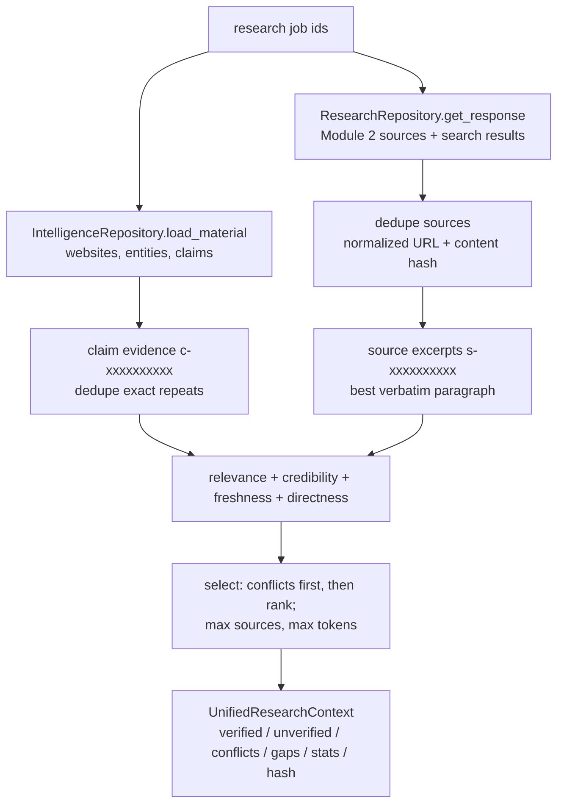

# Research context builder

Code: `backend/app/intelligence/context_builder.py` → `UnifiedResearchContext`.

## Inputs and provenance
Nothing is fetched again; everything comes from the stored Module 2/3 rows. Each
`EvidenceItem` keeps claim id, source id, job id, entity, predicate, value, verbatim
excerpt, source URL/title/domain, content hash, official vs third-party, verification
status, extraction confidence and observation time.

**Stable IDs:** `c-` + the first 10 hex characters of the claim UUID, and `s-` + those of
the source UUID, so IDs survive context rebuilds. Full source texts are kept in memory
only (`source_texts`, excluded from serialization and never persisted) for excerpt
verification.

## Deduplication
- Sources: same normalized URL (host case, `www.`, trailing slash and fragment ignored) or
  the same content hash.
- Claims: only *exact* repeats (same subject, predicate, value and source URL) are
  dropped. Equal claims from **different** sources are kept: independent corroboration
  matters and each source must stay citable.

## Ranking
`rank = 0.50·relevance + 0.25·credibility + 0.10·freshness + 0.15·directness`
- **Relevance:** share of objective and query terms found in the evidence (claims have a
  floor of 0.15). `EvidenceRetriever` is the interface for a future vector retriever.
- **Credibility** (about the *source*, not about whether a claim is true): official docs
  0.90, government/regulatory 0.90, official pricing 0.85, official site 0.75 (marked as
  self-reported marketing), other third-party 0.50, directories (G2, Capterra,
  Crunchbase, …) 0.40, unknown ownership 0.30, search snippet only 0.25. Each score
  carries its explanatory factors.
- **Freshness:** 1.0 for new evidence, falling linearly to 0 at `INTELLIGENCE_FRESHNESS_DAYS`;
  0.5 when the date is unknown.
- **Directness:** supported 1.0, partially supported 0.7, conflicting 0.5, unverified 0.4,
  unsupported 0.1; source excerpt 0.5; snippet 0.2.

## Separation and limits
- *Verified* = supported/partially supported claims. *Unverified* = unverified/unsupported
  claims and bare excerpts. *Conflicts* = claims Module 3 marked conflicting, plus
  differing values of single-valued predicates (headquarters, founded year, company size).
- *Missing information:* for each company, missing headquarters, products/services
  (critical), pricing (critical) and target customers are reported as "not publicly found".
- Limits: `INTELLIGENCE_MAX_SOURCES` (requests can only lower it) and a per-provider
  evidence-token budget (`INTELLIGENCE_CONTEXT_MAX_TOKENS`, overridden by
  `INTELLIGENCE_CONTEXT_MAX_TOKENS_<PROVIDER>`; about 4 characters per token; see
  `llm-cost-management.md`). Trimming is recorded on the analysis and in the report. Conflict evidence is
  selected first; whole websites are never placed in a prompt.
