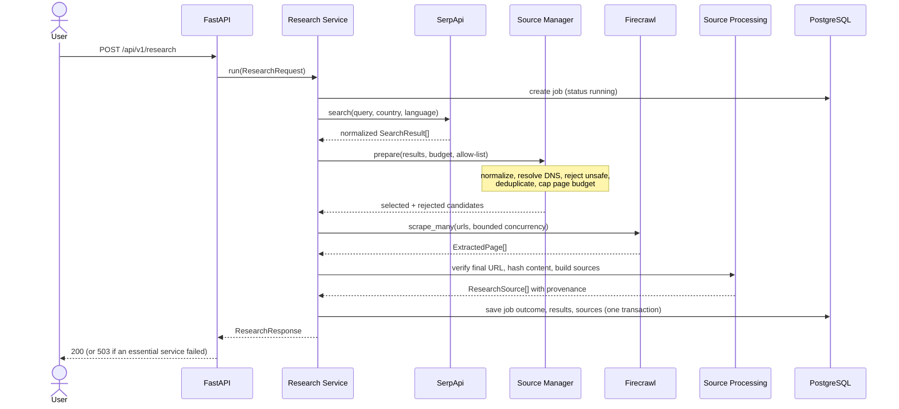

# Research engine (Module 2)

The first functional AURORA subsystem. Given a query it searches the web
(SerpApi), validates the result URLs, extracts page content as Markdown
(Firecrawl), records provenance, persists everything in PostgreSQL and returns a
structured, source-backed response. **No LLM is used**; nothing is summarized or
invented.

## Pipeline

Stages, recorded in `stages[]` with duration, item count and error:
`search` → `validation` → `extraction` → `persistence`. A job that fails can
therefore be attributed to a stage. (`persistence` appears in the `POST`
response; stored jobs retrieved by `GET` list the first three.)

## Execution model

Research is **synchronous**. `POST /api/v1/research` holds the HTTP request open
until the job ends or `RESEARCH_TIMEOUT_SECONDS` (default 60) expires, then
returns the persisted result. There is no queue and no "running" job visible to
clients. Consequences: long jobs can hit client/proxy timeouts, and many
parallel requests consume provider credits and connections. A background-job
model is future work; the service API (`run`/`get`) was kept free of FastAPI so
it can move behind a queue.

Cancellation: if the request task is cancelled (client disconnect), the service
persists the job as `failed` with category `cancelled` and re-raises.

## Job status rules

| Situation | Status |
| --- | --- |
| Search provider failed (auth, rate limit, outage, not configured) | `failed` |
| Deadline exceeded / internal error / cancelled | `failed` |
| Search returned nothing | `completed` (zero sources) |
| Every result rejected or duplicate | `failed` (`no_eligible_urls`) |
| `scrape_pages=false` | `completed`; sources recorded as `skipped` |
| All selected pages failed to extract | `failed` |
| Some pages failed to extract | `partially_completed` |
| All selected pages extracted | `completed` |

URLs rejected by policy are stored as sources with status `rejected` and a
reason code; they do not make a job `partially_completed` (they were never
fetched).

## Components

| Module | Responsibility |
| --- | --- |
| `schemas/research.py` | Request/response/domain models, enums |
| `research/state.py` | `ResearchState` TypedDict for a future LangGraph graph |
| `tools/serpapi_tool.py` | SerpApi search → `SearchResult` |
| `tools/firecrawl_tool.py` | Firecrawl scrape → `ExtractedPage` |
| `tools/http.py`, `tools/errors.py` | Retry/backoff, bounded bodies, error taxonomy |
| `research/url_policy.py` | URL normalization, SSRF policy, redirect tracing |
| `research/source_manager.py` | Validation, dedup, budget, provenance |
| `research/research_service.py` | Orchestration, stage tracking, status rules |
| `database/models.py`, `database/repositories/research_repository.py` | PostgreSQL persistence |
| `api/routes/research.py`, `api/deps.py` | HTTP layer and dependency wiring |

## SerpApi integration

HTTPX `GET https://serpapi.com/search` with `engine=google`, `q`, `num` (1–100),
`gl` (country), `hl` (language), `output=json`, `api_key`. The official
`serpapi` package was not used because it is built on blocking `requests` and
hides `Retry-After`. Organic results are normalized (`position`, `title`,
`link`→`url`, `snippet`, `displayed_link`, `source`→`domain`, plus the SerpApi
`search_id`); entries without a link are skipped, missing titles/snippets become
empty/`None`. "Google hasn't returned any results" is an empty list, not an
error. The API key is a URL query parameter, so request URLs are never logged and
`httpx` log records are redacted.

## Firecrawl integration

HTTPX `POST https://api.firecrawl.dev/v1/scrape` with
`{"url", "formats": ["markdown"], "onlyMainContent": true, "timeout"}` and a
`Bearer` token — the same endpoint the installed `firecrawl-py` 1.17 calls (the
SDK is synchronous and hides retry metadata). The response
`{"success": true, "data": {"markdown", "metadata": {...}}}` is normalized into
`ExtractedPage`. Content larger than `RESEARCH_MAX_CONTENT_CHARS` (default
200 000) is truncated and flagged (`metadata.truncated`); provider responses are
capped at 8 MiB. Only single pages are scraped — there is no crawling.

> **Live verification is pending.** Request/response shapes were taken from the
> installed SDK source and public API, and are exercised only by mocked tests.
> Run the opt-in live tests (see `docs/testing-guide.md`) with real keys to
> confirm, in particular that `metadata.url`/`statusCode` are populated as
> assumed.

## Retries, timeouts and rate limits

* Retry only transient failures: HTTP 408/425/429/5xx, timeouts, network errors.
* Never retry 401/402/403 (authentication), other 4xx, or malformed responses.
* At most `RESEARCH_MAX_RETRIES` retries (default 3); wait
  `uniform(0, min(8, 0.5·2^attempt))` seconds (full jitter), but not less than
  `Retry-After` (seconds or HTTP-date, capped at 30 s).
* Explicit connect/read timeouts (`RESEARCH_HTTP_*_TIMEOUT_SECONDS`), DNS timeout
  (`RESEARCH_DNS_TIMEOUT_SECONDS`), overall job deadline
  (`RESEARCH_TIMEOUT_SECONDS`) and database connect timeout.
* Concurrency: `RESEARCH_MAX_CONCURRENT_EXTRACTIONS` (default 3) bounds
  Firecrawl calls; URL validation DNS lookups are bounded to 10 at a time.

## Error handling

Provider errors (`tools/errors.py`) never include URLs, keys or response bodies.
The service turns them into a failed stage/job with a stable `category`
(`provider_authentication_error`, `provider_rate_limited`,
`provider_unavailable`, `provider_not_configured`, `provider_error`,
`deadline_exceeded`, `no_eligible_urls`, `internal_error`, `cancelled`, ...).
Infrastructure categories map to HTTP 503. See `docs/api-documentation.md`.

## Observability

Logs are `event key=value` lines carrying `research_job_id`, `stage`, `status`,
`duration_ms` and `error_category`, plus a per-request correlation id
(`X-Request-ID`). Queries, page content, keys and headers are not logged.

## Boundary with future LangGraph orchestration

`ResearchService` is a plain async class. Each stage (`_do_search`,
`_do_validate`, `_do_extract`, persistence) already reads/writes a
`ResearchState`-shaped bag of data. In Module 3+ a LangGraph graph can wrap
these as nodes over `ResearchState`, add checkpointing and human approval, and
call `ResearchService`/its collaborators — without changing the adapters,
source manager or repository. Agents must not bypass `SourceManager` for any
fetch.
