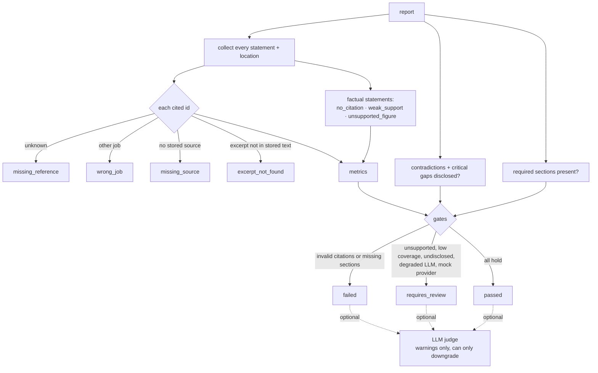

# Research quality evaluation

Code: `backend/app/intelligence/quality_evaluator.py`; table `report_quality_evaluations`.



## Citation validation (deterministic)
For each cited id the evaluator checks that it exists in the context, belongs to one of the
analysis's research jobs, has a stored source, and (when the source text is stored) that
its verbatim excerpt occurs in that text, ignoring whitespace and case. A citation being
present is not treated as support. For **factual** statements (`fact`, `observation`) it
also checks:
- `no_citation`: no evidence cited.
- `weak_support`: fewer than 25% of the statement's distinctive terms appear in the cited
  evidence.
- `unsupported_figure`: a number in the statement (price, year, count, percentage) appears
  in none of the cited evidence. This catches invented statistics, customer counts, market
  shares and prices.

Contradictions are preserved and must be disclosed. Pricing conflicts, conflicting dates
and differing single-valued facts come from the context builder and Module 3; currency and
billing periods are checked by Module 3's pricing validation.

## Metrics
See the module docstring for exact formulas: citation coverage, evidence coverage,
unsupported claim count, invalid citation count, contradiction count (and undisclosed
count), relevance score, completeness score, source diversity (`min(1, domains/3)`),
source freshness, structural validity and missing sections. **None of these measures
factual accuracy.**

## Gates
| Condition | Result |
| --- | --- |
| any invalid citation | `failed` |
| required section missing (methodology, scope, limitations; plus summary, findings, sources when there is evidence; comparisons for comparison types) | `failed` |
| unsupported factual statements > `INTELLIGENCE_MAX_UNSUPPORTED_CLAIMS` (0) | `requires_review` |
| citation coverage < `INTELLIGENCE_MIN_CITATION_COVERAGE` (0.8) | `requires_review` |
| undisclosed contradiction or critical gap | `requires_review` |
| degraded LLM run or mock provider | `requires_review` |

A report that does not pass is never marked approved. The analysis status becomes
`requires_review` (or `partially_completed` if the LLM degraded).

## Optional LLM judge
`INTELLIGENCE_ENABLE_LLM_EVALUATION=true` sends cited statements and their evidence to the
`quality_evaluation` prompt. Its issues are recorded as warnings and can only lower the
status, never raise it. Budget errors simply skip it.

## Evaluating report quality repeatably
`scripts/evaluate_module4.py` runs a fixed set of 12 research objectives through the full
pipeline and writes `docs/module-4-evaluation.md`:

```powershell
$env:PYTHONPATH = "backend"
python scripts/evaluate_module4.py                 # offline: fixture data + fault-planting fake provider, no cost
$env:AURORA_RUN_LIVE_LLM_TESTS = "true"
python scripts/evaluate_module4.py --live --job-id <research job uuid> --limit 2   # spends Groq credits
```

Offline mode proves the *validation layer*: the fake provider cites real ids and also plants
an invented id, an unsupported figure and a ranking claim; the run fails unless all three are
caught. Live mode records the automated metrics for real model output but cannot judge
factual correctness; the generated file has a separate manual-review table for that.
Automated columns are never a substitute for reading the report against its cited sources.
