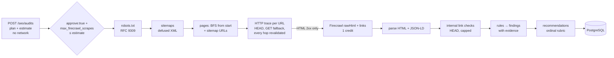

# Technical SEO audit (Phase 2)

AURORA audits a website's technical SEO from **raw HTML and HTTP observations**: robots.txt,
XML sitemaps, status codes, redirect chains, response headers, `<head>` metadata, headings,
images, links and JSON-LD. Every finding carries its affected URLs and evidence. Recommendations
are ordered by an ordinal rubric with verification steps. Results are stored in PostgreSQL and
shown on the dashboard's **Technical SEO** tab.

Code: `backend/app/seo/technical/`, API `backend/app/api/routes/seo.py`, migration
`0005_technical_seo`, UI `frontend/src/pages/TechnicalSeoPage.tsx`.

## Flow

## What is collected, and from where

| Signal | Source | Notes |
| --- | --- | --- |
| Status, redirect chain (every hop and its status), headers | `UrlPolicy.trace_http` (direct HEAD; GET without reading the body if HEAD answers 405/501) | Only `content-type`, `content-language`, `x-robots-tag`, `link`, `last-modified` and `cache-control` are kept |
| Title(s), meta description(s), meta robots/googlebot, canonical(s), hreflang, `html lang`, viewport, charset, meta refresh, `<base>`, Open Graph | Raw HTML from Firecrawl (`formats: ["rawHtml","links"]`, `onlyMainContent: false`) | Parsed with BeautifulSoup `html.parser`. **Markdown is never used** |
| Headings H1–H6, images (alt missing vs `alt=""`), links (internal/external, `rel`, navigation vs content), mixed content | Same raw HTML | Lists capped (1,000 links, 200 headings) |
| JSON-LD | `<script type="application/ld+json">` | Syntax, vocabulary and search-feature checks are kept separate (see below). Microdata/RDFa presence is detected, not validated |
| robots.txt | Direct GET, no automatic redirects (up to 4 validated hops), 512 KB cap | RFC 9309 matching (`*`, `$`, longest match, Allow wins ties). 4xx means no restrictions; 5xx or unreachable means a crawler should assume full disallow |
| Sitemaps | robots.txt `Sitemap:` lines (same site only), else `/sitemap.xml`; sitemap indexes followed up to `SEO_AUDIT_MAX_SITEMAPS` | DOCTYPE/ENTITY declarations rejected; gzip supported with the same size cap |
| Internal link status | HEAD traces of link targets not audited as pages, most-linked first, up to `SEO_AUDIT_MAX_LINK_CHECKS` | Targets beyond the cap stay `unverified`, never assumed broken |

**Safety:**
- Every URL and redirect hop passes `UrlPolicy`: public addresses only, http(s), allowed ports,
  and the audited site, with or without `www.`. The start URL is DNS-validated when the audit
  runs.
- robots.txt is honoured for AURORA's own user agent: disallowed URLs are recorded and never
  requested. Googlebot's verdict is recorded separately.
- Firecrawl is called only for pages whose trace ends in an HTML 2xx response, so error pages
  and redirects cost no credits.

## Budgets and approval

- `POST /api/v1/seo/audits` stores a `planned` audit with upper bounds: Firecrawl scrapes
  (= max pages) and direct requests. It makes no network request.
- `POST /api/v1/seo/audits/{id}/run` requires `{"approve": true, "max_firecrawl_scrapes": N}` with
  N ≤ the estimate. It returns 503 before anything is changed if Firecrawl is not configured, and
  409 if the audit is not `planned` or another audit of the site is running.
- During the run, an httpx request hook counts every direct request; scrapes are reserved before
  each Firecrawl call. Reaching either ceiling, or `SEO_AUDIT_MAX_DURATION_SECONDS`, stops the
  collection; the audit ends `partially_completed` with `coverage.stopped_reason`.
- Runs are synchronous: the request waits. A background runner is planned for Phase 1.

## Rules (check ids)

**Crawl access**
- `robots.unavailable`, `robots.disallows_root`, `robots.blocks_pages`, `robots.no_sitemap_reference`
- `sitemap.missing`, `sitemap.invalid`, `sitemap.lists_non_200`, `sitemap.lists_noindex`,
  `sitemap.lists_non_canonical`

**Status, redirects, transport**
- `status.5xx`, `status.4xx`
- `redirect.chain` (more than one hop), `redirect.loop_or_too_long`, `redirect.temporary`
- `security.http_final_url`, `security.mixed_content`

**Indexability:** `indexability.noindex` (meta robots/googlebot or `X-Robots-Tag`; directives scoped
to another crawler are ignored), `indexability.meta_refresh`

**Metadata and structure**
- `title.missing`, `title.multiple`, `title.duplicate`, and `title.length`. The length check is a
  display heuristic of fewer than 10 or more than 60 characters, labelled as such.
- `description.missing`, `description.duplicate`, `description.multiple`
- `headings.h1_missing`, `headings.h1_multiple`, `images.alt_missing`, `html.lang_missing`,
  `html.viewport_missing`

**Canonical:** `canonical.missing`, `canonical.conflicting`, `canonical.invalid`,
`canonical.points_elsewhere` (info: often intended), `canonical.target_not_200`,
`canonical.http_header`

**hreflang:** `hreflang.invalid_code`, `hreflang.missing_self`, `hreflang.no_return_link`
(between audited pages only; evidence `inferred`)

**Structured data:** `schema.parse_error`, `schema.vocabulary`, `schema.missing_required`,
`schema.missing_recommended`, `schema.retired_feature`, `schema.disagrees_with_page`

**Links:** `links.broken_internal` (4xx/5xx targets; affected URLs are the pages carrying the
links), `links.redirecting_internal`

Duplicates and hreflang reciprocity are computed **within the audited sample**, and the finding
text says so.

### Structured data: three separate questions
Method: `seo-toolkit-schema` and `seo-schema`.
1. **Syntax:** does the block parse as JSON?
2. **Vocabulary:** is there a schema.org `@context` and an `@type`?
3. **Feature requirements:** AURORA's documented rule set (`structured_data.FEATURE_RULES`,
   version `aurora-sd-1`). It covers Product, BreadcrumbList, LocalBusiness, Event, VideoObject,
   Recipe, JobPosting, the Article types, Organization, WebSite, SoftwareApplication and Person.
   Missing required properties are warnings; missing recommended ones are info. This is a
   checklist to confirm in Google's Rich Results Test, **never a promise of a rich result**.

Retired features are reported as info, never as errors: FAQ (fully retired 2026-05-07), HowTo,
ClaimReview, VehicleListing, SpecialAnnouncement, EstimatedSalary, and the sitelinks
SearchAction. The source is `.claude/skills/seo-schema/references/deprecated-types-2024-2026.md`.
Markup is only read; nothing is generated or filled in.

## Indexability

Each page gets one of two states:
- `not_indexable`, with reasons: robots.txt disallows Googlebot, redirects, non-2xx status,
  noindex, or canonical points elsewhere.
- `indexable_candidate`: no blocking signal was observed.

**A 200 response is not proof of indexing.** The state is always shown with the note that actual
index status needs Search Console URL Inspection, which is not connected.

## Recommendations

Method: `seo-toolkit-prioritization`. Each finding gets one recommendation from
`recommendations.CATALOG`: an action, a typical effort and risk, a base confidence and
verification steps. All values are labels; there are no numeric scores.
- **impact:** follows severity, raised one step when the homepage or at least half the audited
  pages are affected. It is a planning judgment, not a traffic forecast.
- **confidence:** the catalog value, lowered one step for `inferred` evidence.
- **tier:** `blocker` (high severity and high impact), `cheap_certainty` (low effort, high
  confidence), `high_leverage`, `maintenance`, or `deferred` (info).
- **order:** tier, then impact, confidence, effort, then affected count.

Where Google's own view matters (noindex, canonicals, robots), verification names Search Console
URL Inspection as the check AURORA cannot run yet.

## Evidence and provenance

Every finding stores up to 25 evidence items, each with:
- `url` and `page_id`;
- `source`: `http_trace`, `firecrawl_raw_html`, `robots_txt`, `sitemap` or `link_check`;
- `observed`: the specific values;
- `observed_at`;
- for HTML evidence, `html_sha256`, the hash of the exact HTML that was parsed.

The full list of affected URLs is stored too (up to 500). Raw HTML is **not stored**; pages keep
the extracted signals and the hash.

## Not measured (stated in every report)
- Core Web Vitals (LCP, INP, CLS), field or lab: no data source is connected. Nothing is
  estimated.
- Index status: needs Search Console.
- Raw-versus-rendered HTML differences: Firecrawl returns browser-rendered HTML, so markup added
  by JavaScript is included, and a page whose server HTML lacks it is not detected.
- External link status, backlinks, page speed, and content quality beyond structure.

## Limitations
- **Rendering:** the "raw HTML" is what Firecrawl's browser produced, not a byte-exact server
  response. Headers come from AURORA's own direct HEAD/GET, which can differ from what Firecrawl
  saw (geo, bot handling).
- **Sample size:** the audit covers at most `SEO_AUDIT_MAX_PAGES` (default 25, cap 200), so
  site-wide statements are about the sample. Orphan pages are not detected yet.
- **Direct-request trust:** the TOCTOU limitation of DNS validation applies to direct requests,
  as for robots.txt in Module 3 (`docs/security-and-ssrf.md`).
- **Not live-verified:** all tests use a scripted site and a fake scraper.
- **Credits:** a raw-HTML scrape is one Firecrawl request; how your plan bills the `rawHtml` and
  `links` formats is not verified here.
