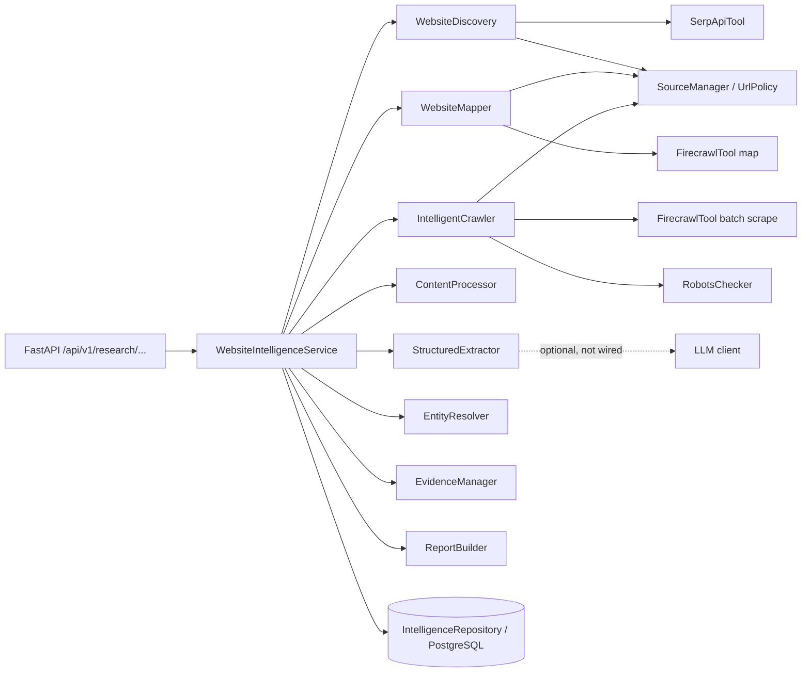
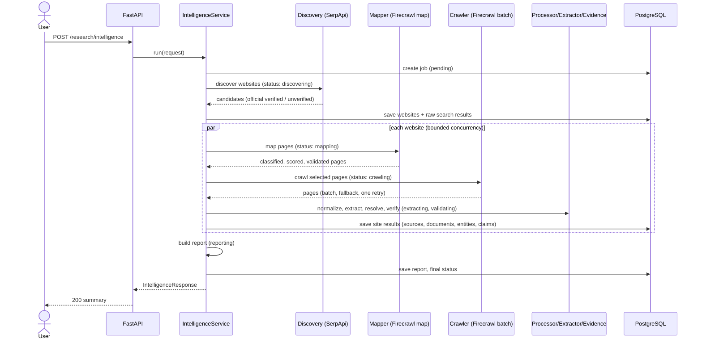
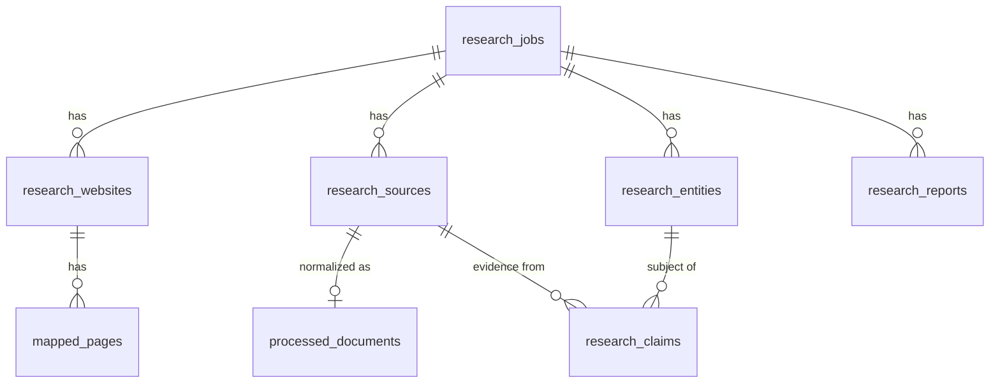

# Website intelligence engine (Module 3)

Module 3 extends the Module 2 research engine from "search results and pages" to
"websites and evidence-backed facts". It discovers relevant websites, decides
which are official, maps their pages, crawls the most relevant ones, normalizes
the content, extracts structured entities, checks every claim against the stored
page text, and renders a report. **No LLM is used by default**; every fact keeps a
source URL and a verbatim excerpt.

Module 2 (`POST /api/v1/research`, `GET /api/v1/research/{job_id}`) is unchanged
and still works. Module 3 reuses its `SerpApiTool`, `FirecrawlTool`, `UrlPolicy`,
`SourceManager`, error taxonomy, retry helper, session/repository pattern, and the
`research_jobs` / `research_sources` / `search_results` tables.

## Architecture

## Execution sequence

## Pipeline components

| Module | Responsibility |
| --- | --- |
| `research/website_discovery.py` | Query generation, validation, domain dedup, ranking, official-site assessment |
| `research/website_mapper.py` | Firecrawl map, URL validation/exclusion, page classification and scoring |
| `research/intelligent_crawler.py` | Page selection, revalidation, robots, batch scrape, fallback, retry, audit |
| `research/robots.py` | Best-effort robots.txt pre-filter |
| `research/content_processor.py` | Markdown normalization, boilerplate removal, dedup, sections |
| `research/structured_extractor.py` | Deterministic extraction + optional validated LLM interface |
| `research/entity_resolver.py` | Conservative entity merging with reasons and stable ids |
| `research/evidence_manager.py` | Excerpt verification, source kinds, conflicts, coverage |
| `research/research_report.py` | JSON + Markdown reports from structured data |
| `research/website_intelligence_service.py` | Orchestration, statuses, persistence, deadline, cancellation |
| `database/repositories/intelligence_repository.py` | PostgreSQL access for the above |

## Job status

`pending -> discovering -> mapping -> crawling -> extracting -> validating ->
reporting -> completed | partially_completed | failed`. Status moves forward
monotonically while websites are processed concurrently, and is stored in
`research_jobs.status` (Module 2 reads in-progress values as `running`).

* `completed`: at least one site produced pages and nothing failed.
* `partially_completed`: some sites/pages failed, the deadline hit, or the job was
  cancelled, but useful data exists.
* `failed`: no site produced a page (or discovery failed).

A failure on one website is recorded (`errors`) and never stops the others. Each
website's data is persisted as soon as that website finishes.

## Execution model

Everything is **synchronous**: `POST /research/intelligence` blocks until the job
ends or `WEBSITE_RESEARCH_TIMEOUT_SECONDS` (default 300) passes. There is no
background queue (Celery/Redis were deliberately not added). Completed websites
are kept when the deadline expires; cancellation (client disconnect) persists the
job state and re-raises. For large jobs use the staged endpoints
(`/websites` -> `/websites/{id}/map` -> `/websites/{id}/crawl`), which also let a
human review the website list before spending crawl credits.

## Why Firecrawl `/v1/crawl` is not used

Firecrawl's crawl endpoint follows links on *its* side, so AURORA could not
validate each URL (SSRF policy, domain scope, robots) before it is fetched.
Instead AURORA maps the site, selects pages itself, revalidates every URL, and
submits an explicit list to the batch-scrape API (with an individual-scrape
fallback). "Crawl depth" therefore means URL path depth during mapping.

## Data model

Module 3 adds `research_websites`, `mapped_pages`, `processed_documents`,
`research_entities`, `research_claims`, `research_reports` and a `job_type`
column on `research_jobs` (migration `0002`, additive). See
`docs/database-design.md`.

## Configuration

All limits are settings (see `.env.example`): `WEBSITE_RESEARCH_MAX_WEBSITES`
(10), `_MAX_PAGES_PER_SITE` (20), `_MAX_TOTAL_PAGES` (100, split evenly across
sites), `_MAX_CRAWL_DEPTH` (2), `_MAX_CONCURRENT_SITES` (2),
`_MAX_CONCURRENT_PAGES` (3), `_TIMEOUT_SECONDS` (300), `_MAX_CONTENT_SIZE_MB` (5),
`_MAX_MAP_URLS` (200), `_ENABLE_LLM_EXTRACTION` (false), `_ENABLE_REPORTS` (true),
`_RESPECT_ROBOTS` (true). Module 2 settings (`RESEARCH_*`) still apply to HTTP
timeouts, retries and DNS.

## Observability

Structured `event key=value` logs carry `research_job_id`, domain, counts and
durations (`website_discovery`, `website_mapped`, `website_crawled`,
`content_processed`, `structured_extraction`, `evidence_validated`,
`report_generated`, `intelligence_finished`). Page content, queries and keys are
never logged. Stage timings are stored on the job and returned by
`GET /{job_id}/progress`.

## Performance notes and limitations

* Sync execution can exceed client/proxy timeouts; use the staged endpoints.
* Sites are processed concurrently (2 by default) but share one database session,
  so writes are serialized by a lock.
* Firecrawl batch jobs are polled (2 s x up to 30); very slow sites fall back to
  limited individual scraping.
* Batch results beyond the first response page (`next` cursors) are not followed.
* Entity resolution and extraction are deterministic and English-centric.
* No cross-job caching yet (content hashes are stored for it).
* Live behaviour of the Firecrawl `/v1/map` and `/v1/batch/scrape` calls is
  unverified (mocked tests only); see `docs/module-3-checklist.md`.

## Boundary with future LangGraph orchestration

`WebsiteIntelligenceService` is a plain async pipeline. Each phase
(`_discover_phase`, `_map_site`, `_crawl_extract_validate`, `_persist_site`,
`_rebuild_report`) can become a LangGraph node over a state object, gaining
checkpointing, retries and human approval, without changing the components
above. Agents must keep going through `SourceManager` for every fetch.
